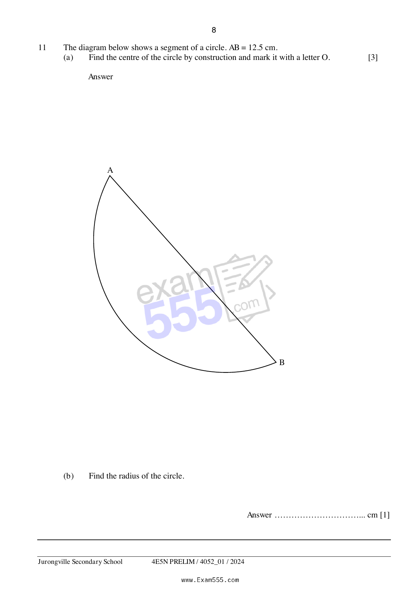

## Question

> **Marks:** (a) 3, (b) 1; total 4
> **Page:** 8

The diagram below shows a segment of a circle. $AB = 12.5\text{ cm}$.

**(a)** Find the centre of the circle by construction and mark it with a letter $O$. [3]

**(b)** Find the radius of the circle. [1]
