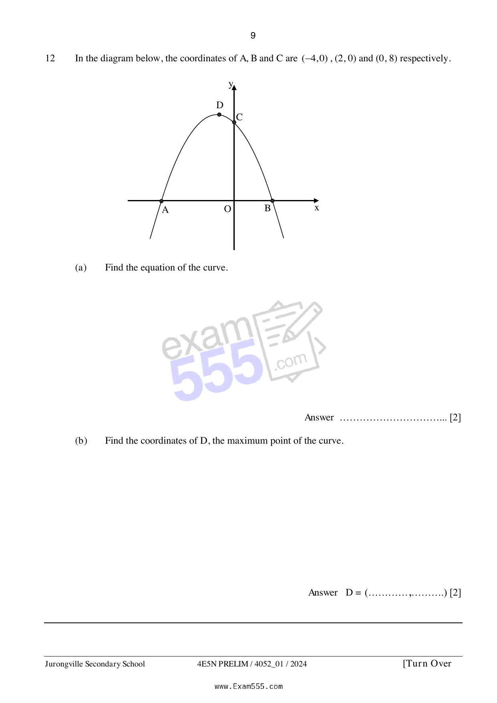

## Question

> **Marks:** (a) 2, (b) 2; total 4
> **Page:** 9

In the diagram below, the coordinates of $A$, $B$ and $C$ are $(-4, 0)$, $(2, 0)$ and $(0, 8)$ respectively.

**(a)** Find the equation of the curve. [2]

**(b)** Find the coordinates of $D$, the maximum point of the curve. [2]
