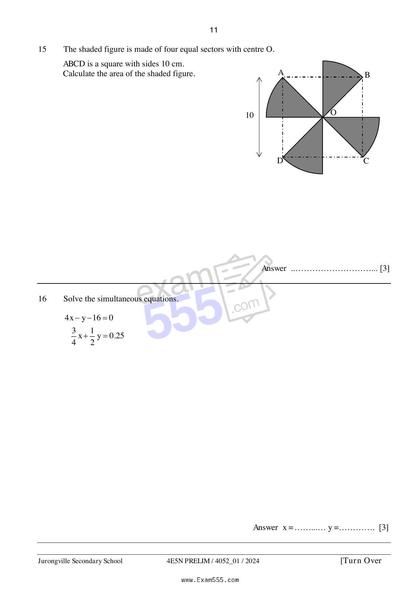

## Question

> **Marks:** 3
> **Page:** 11

The shaded figure is made of four equal sectors with centre $O$.
$ABCD$ is a square with sides $10\text{ cm}$.
Calculate the area of the shaded figure. [3]

