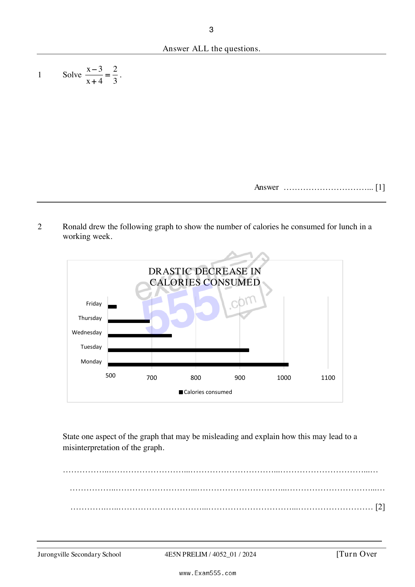

## Question

> **Marks:** 2
> **Page:** 3

Ronald drew the following graph to show the number of calories he consumed for lunch in a working week.

State one aspect of the graph that may be misleading and explain how this may lead to a misinterpretation of the graph. [2]
