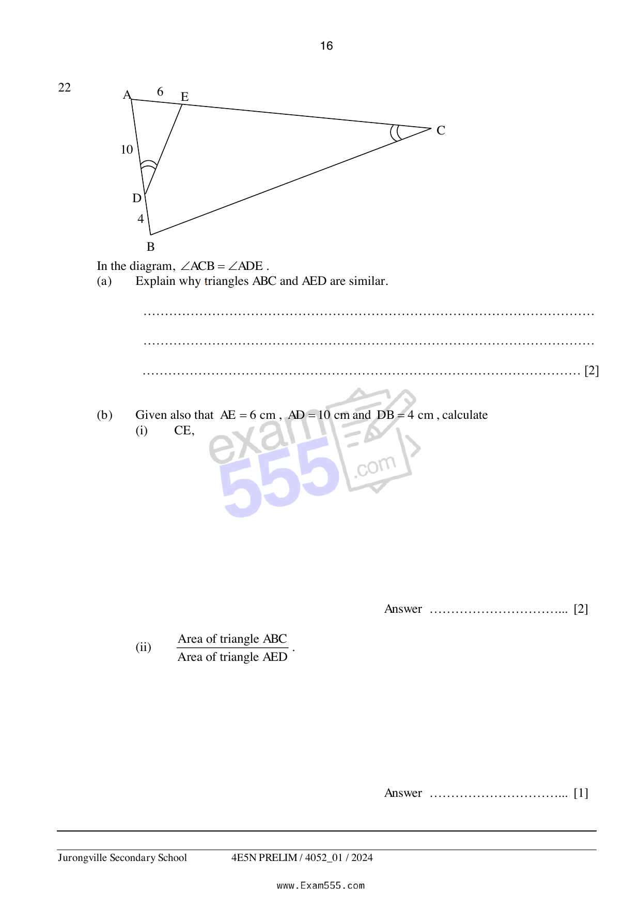

## Question

> **Marks:** (a) 2, (b)(i) 2, (b)(ii) 1; total 5
> **Page:** 16

In the diagram, $\angle ACB = \angle ADE$.

**(a)** Explain why triangles $ABC$ and $AED$ are similar. [2]

**(b)** Given also that $AE = 6\text{ cm}$, $AD = 10\text{ cm}$ and $DB = 4\text{ cm}$, calculate

(i) $CE$, [2]

(ii) $\dfrac{\text{Area of triangle }ABC}{\text{Area of triangle }AED}$. [1]
