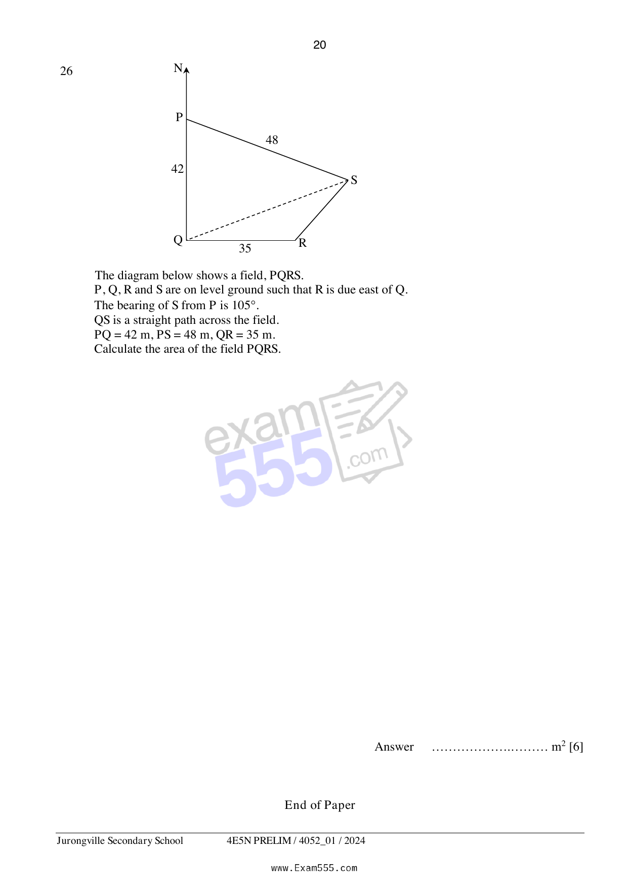

## Question

> **Marks:** 6
> **Page:** 20

The diagram shows a field, $PQRS$.
$P$, $Q$, $R$ and $S$ are on level ground such that $R$ is due east of $Q$.
The bearing of $S$ from $P$ is $105^{\circ}$.
$QS$ is a straight path across the field.
$PQ = 42\text{ m}$, $PS = 48\text{ m}$, $QR = 35\text{ m}$.
Calculate the area of the field $PQRS$. [6]
