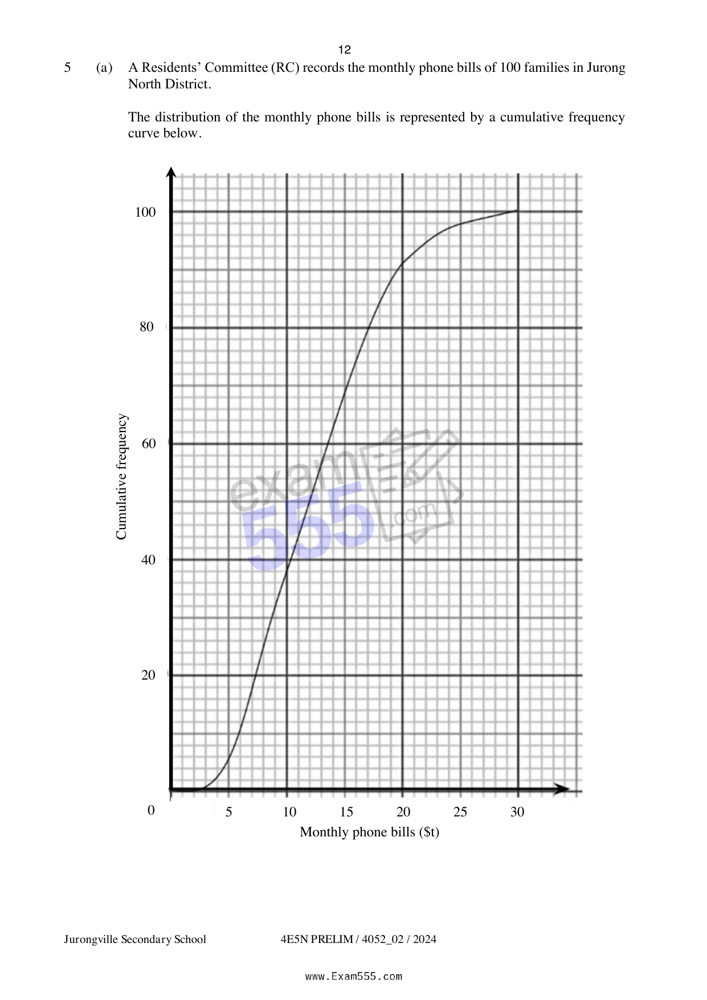

## Question

> **Marks:** (a)(i) 1, (a)(ii) 1, (a)(iii) 1, (a)(iv) 2, (a)(v) 1, (b)(i) 1, (b)(ii) 2, (b)(iii) 2; total 11
> **Page:** 12–15

**(a)** A Residents’ Committee (RC) records the monthly phone bills of $100$ families in Jurong North District.

The distribution of the monthly phone bills is represented by a cumulative frequency curve below.

(i) Complete the following grouped frequency table for the monthly phone bills, ＄$t$, of Jurong North District. [1]

| Monthly phone bills (＄$t$) | Frequency |
| --- | --- |
| $0 < t \leq 10$ | $38$ |
| $10 < t \leq 20$ |  |
| $20 < t \leq 30$ | $9$ |

(ii) Calculate an estimate of the mean. [1]

(iii) Calculate an estimate of the standard deviation. [1]

(iv) Find the interquartile range of the distribution.

Is there any difference between using standard deviation and interquartile range to estimate the spread of the monthly phone bills in Jurong North district?

Explain. [2]

(v) It is recorded that another district, known as Clementine district, has a median monthly phone bill of ＄$17$.

The Chairman of the RC in Clementine district claims that his residents spend less on average monthly phone bills as compared to residents in Jurong North district.

Explain if his claim is justified. [1]

**(b)** In a community event, cash vouchers are given as lucky draw prizes to the selected $100$ families in Jurong North district.

The table below shows the information about the number of families with senior citizens in Jurong North district.

Each family has at most one senior citizen who belongs to either the Pioneer or Merdeka generation.

|  | Pioneer Generation | Merdeka Generation |
| --- | --- | --- |
| Stay alone | 30 | 25 |
| Stay with dependents | 5 | 6 |

(i) One family is selected at random from Jurong North District.

Find the probability that this family has no senior citizen. [1]

(ii) Two families are selected at random from Jurong North District.

Find the probability that both families have senior citizens who belong to the Merdeka Generation. [2]

(iii) Both families have senior citizens who belong to the Pioneer Generation, but one of them stay alone. [2]
