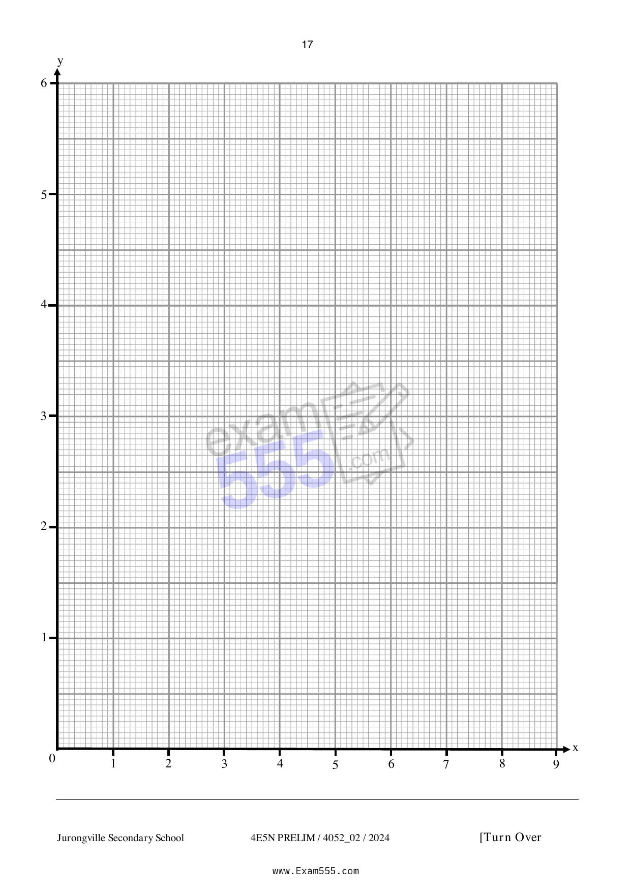

## Question

> **Marks:** (a) 1, (b) 3, (c) 1, (d) 2, (e)(i) 2, (e)(ii) 1, (e)(iii) 2; total 12
> **Page:** 16–17

**(a)** Complete the table of values for $y = \dfrac{24}{x}+x-9$.

Give your answer correct to one decimal place. [1]

| $x$ | $2$ | $2.3$ | $2.6$ | $3$ | $4$ | $5$ | $6$ | $7$ | $8$ |
| --- | --- | --- | --- | --- | --- | --- | --- | --- | --- |
| $y$ | $5$ | $3.7$ | $2.8$ | $2$ | $1$ | $0.8$ | $1$ |  | $2$ |

**(b)** On the grid, draw the graph of $y = \dfrac{24}{x}+x-9$, for $2 \leq x \leq 8$. [3]

**(c)** Use your graph to find the range of values of $x$ for which $\dfrac{24}{x}+x \leq 10\dfrac{1}{2}$. [1]

**(d)** On the same grid, draw a tangent and find the gradient of the curve at $(4, 1)$. [2]

**(e)** (i) On the same grid, draw the graph of $y = \dfrac{1}{2}x+1$ for $2 \leq x \leq 8$. [2]

(ii) Write down the $x$-coordinate of the point where this line intersects the curve. [1]

(iii) This value of $x$ has a solution of the equation $Ax^{2}+Bx+48 = 0$.

Find the value of $A$ and the value $B$. [2]
