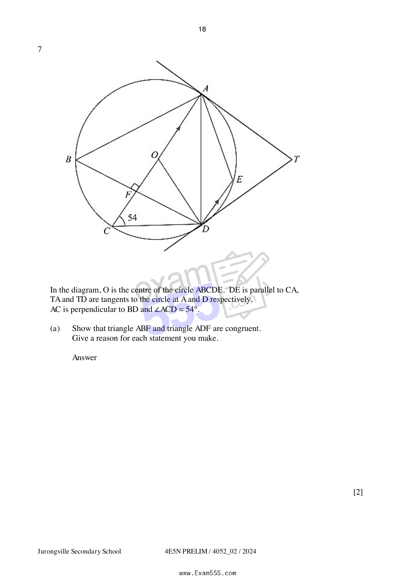

## Question

> **Marks:** (a) 2, (b)(i) 1, (b)(ii) 1, (b)(iii) 2, (b)(iv) 1, (b)(v) 1; total 8
> **Page:** 18–19

In the diagram, $O$ is the centre of the circle $ABCDE$. $DE$ is parallel to $CA$, $TA$ and $TD$ are tangents to the circle at $A$ and $D$ respectively.
$AC$ is perpendicular to $BD$ and $\angle ACD = 54^{\circ}$.

**(a)** Show that triangle $ABF$ and triangle $ADF$ are congruent.
Give a reason for each statement you make. [2]

**(b)** By stating your reasons clearly, find

(i) angle $CAD$, [1]

(ii) angle $AOD$, [1]

(iii) angle $CAE$, [2]

(iv) angle $BAT$, [1]

(v) angle $ATD$. [1]
