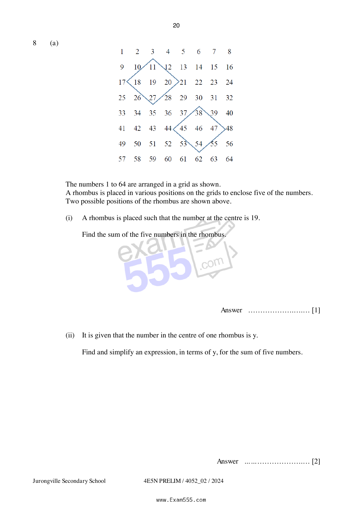
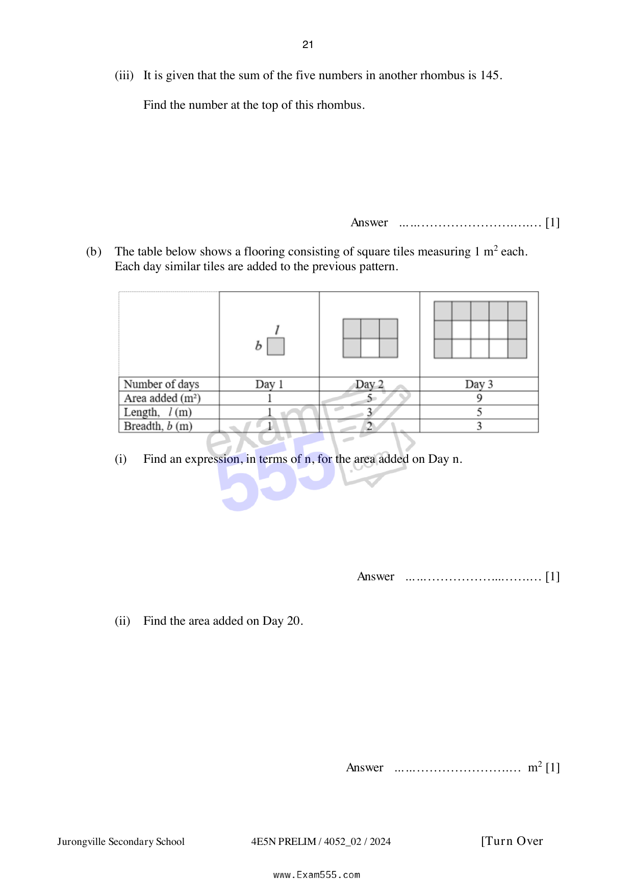

## Question

> **Marks:** (a)(i) 1, (a)(ii) 2, (a)(iii) 1, (b)(i) 1, (b)(ii) 1, (b)(iii) 1, (b)(iv) 2, (b)(v) 2; total 11
> **Page:** 20–22

**(a)** The numbers $1$ to $64$ are arranged in a grid as shown.
A rhombus is placed in various positions on the grids to enclose five of the numbers.
Two possible positions of the rhombus are shown above.

(i) A rhombus is placed such that the number at the centre is $19$.

Find the sum of the five numbers in the rhombus. [1]

(ii) It is given that the number in the centre of one rhombus is $y$.

Find and simplify an expression, in terms of $y$, for the sum of five numbers. [2]

(iii) It is given that the sum of the five numbers in another rhombus is $145$.

Find the number at the top of this rhombus. [1]

**(b)** The table below shows a flooring consisting of square tiles measuring $1\text{ m}^{2}$ each.
Each day similar tiles are added to the previous pattern.

(i) Find an expression, in terms of $n$, for the area added on Day $n$. [1]

(ii) Find the area added on Day $20$. [1]

(iii) Explain why the area added is always odd. [1]

(iv) Find an expression for the total area of the flooring in the form of $an^{2}+bn$, on Day $n$. [2]

(v) Determine if a total area of $780\text{ m}^{2}$ of flooring can be completed in $3$ weeks. [2]
