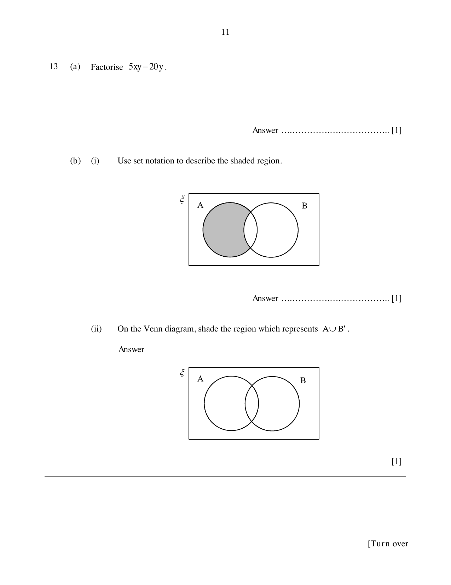
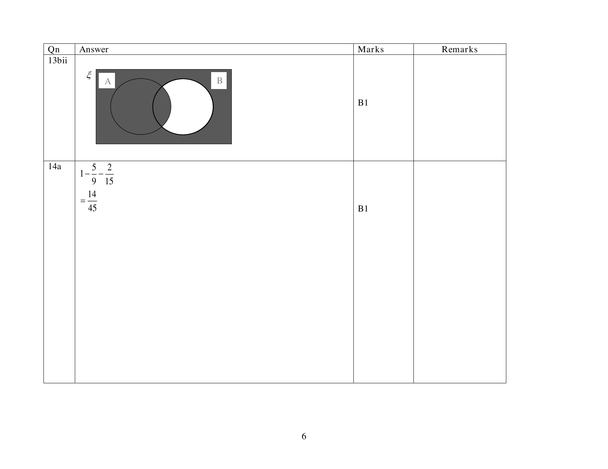

## Question

> **Marks:** (a) [1]; (b)(i) [1]; (b)(ii) [1]
> **Page:** 11

**(a)** Factorise $5xy-20y$.

**(b) (i)** Use set notation to describe the shaded region.

**(ii)** On the Venn diagram, shade the region which represents $A\cup B'$.

## Answer Scheme

**(a)** $5y(x-4)$

**(b) (i)** $A\cap B'$. Also accepted: $A'\cap B'$ is not the shaded set; the scheme also lists $B'\cap(A\cup B)$.

The shaded region is $A\cap B'$.

**(ii)** Shade $A\cup B'$: all of $A$, and everything outside $B$.

