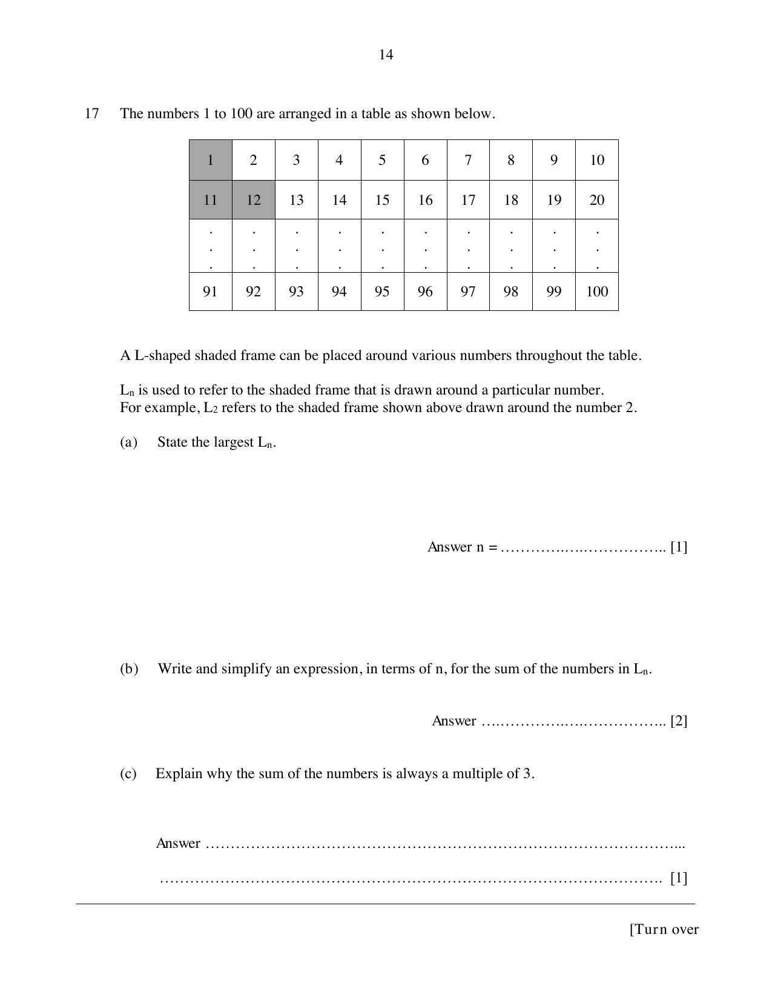

## Question

> **Marks:** (a) [1]; (b) [2]; (c) [1]
> **Page:** 14

The numbers 1 to 100 are arranged in a table as shown below.

An L-shaped shaded frame can be placed around various numbers throughout the table.

$L_{n}$ is used to refer to the shaded frame that is drawn around a particular number.
For example, $L_{2}$ refers to the shaded frame shown above drawn around the number 2.

**(a)** State the largest $L_{n}$.

**(b)** Write and simplify an expression, in terms of $n$, for the sum of the numbers in $L_{n}$.

**(c)** Explain why the sum of the numbers is always a multiple of 3.

## Answer Scheme

**(a)** $90$

**(b)** $L_{n} = (n-1)+(n-1)+10+n+10 = 3n+18$

**(c)** $3n+18 = 3(n+6)$, which is a multiple of 3.
