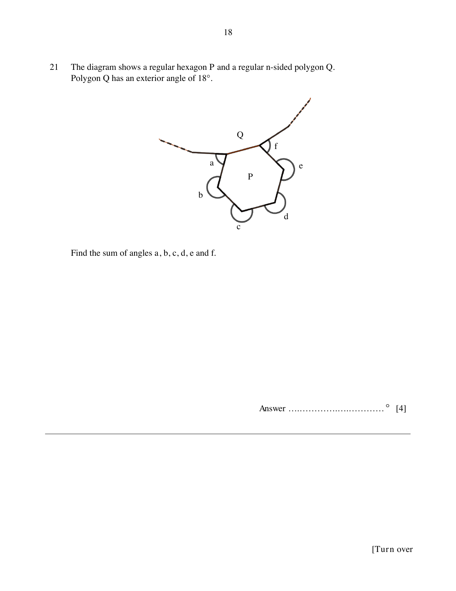

## Question

> **Marks:** [4]
> **Page:** 18

The diagram shows a regular hexagon $P$ and a regular $n$-sided polygon $Q$.
Polygon $Q$ has an exterior angle of $18^{\circ}$.

Find the sum of angles $a$, $b$, $c$, $d$, $e$ and $f$.

## Answer Scheme

Interior angle of $Q = 180^{\circ}-18^{\circ} = 162^{\circ}$.

Sum of interior angles of hexagon $P = (6-2)\times 180^{\circ} = 720^{\circ}$.

$$
\begin{aligned}
162^{\circ}+162^{\circ}+a+b+c+d+e+f+720^{\circ} &= 360^{\circ}\times 6 \\
a+b+c+d+e+f &= 1116^{\circ}
\end{aligned}
$$
