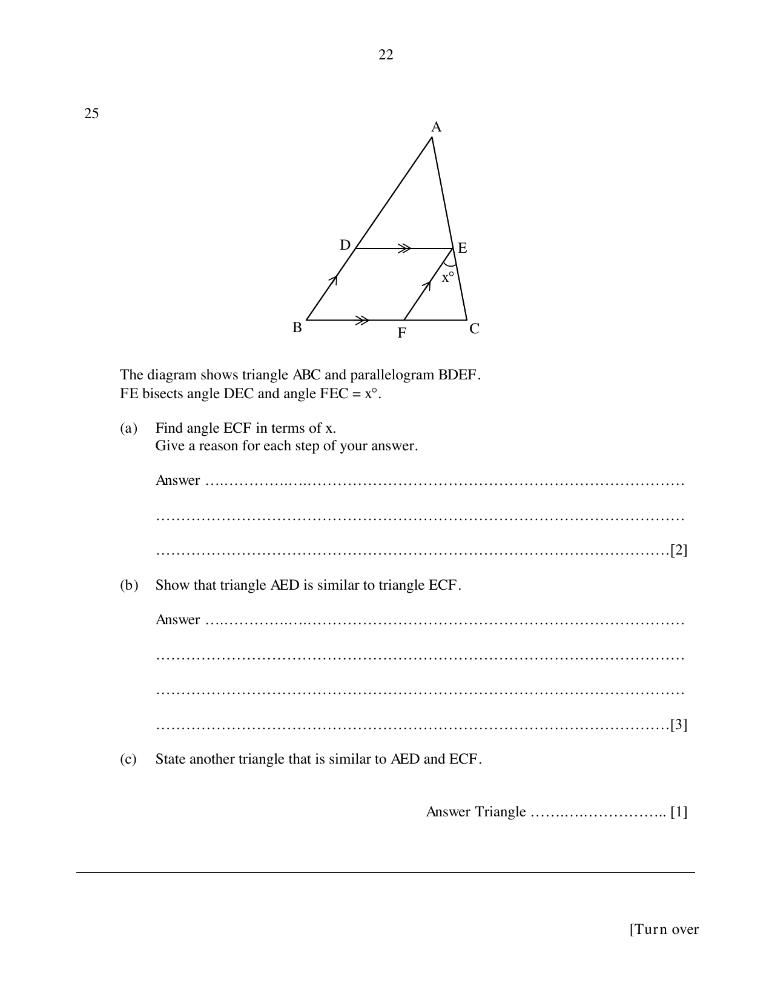

## Question

> **Marks:** (a) [2]; (b) [3]; (c) [1]
> **Page:** 22

The diagram shows triangle $ABC$ and parallelogram $BDEF$.
$FE$ bisects angle $DEC$ and angle $FEC = x^{\circ}$.

**(a)** Find angle $ECF$ in terms of $x$.
Give a reason for each step of your answer.

**(b)** Show that triangle $AED$ is similar to triangle $ECF$.

**(c)** State another triangle that is similar to $AED$ and $ECF$.

## Answer Scheme

**(a)** $\angle DEF = \angle FEC = x^{\circ}$ ($FE$ bisects $\angle DEC$).

$\angle DEF = \angle EFC = x^{\circ}$ (alternate angles, $DE\parallel BC$).

$\angle ECF = 180^{\circ}-x^{\circ}-x^{\circ} = 180^{\circ}-2x^{\circ}$ (angles on a straight line).

**(b)** $\angle DAE = \angle FEC = x^{\circ}$ (corresponding angles, $FE\parallel DA$).

$\angle AED = \angle ECF = 180^{\circ}-2x^{\circ}$.

Triangle $AED$ is similar to triangle $ECF$ (AA).

**(c)** Triangle $ACB$.
