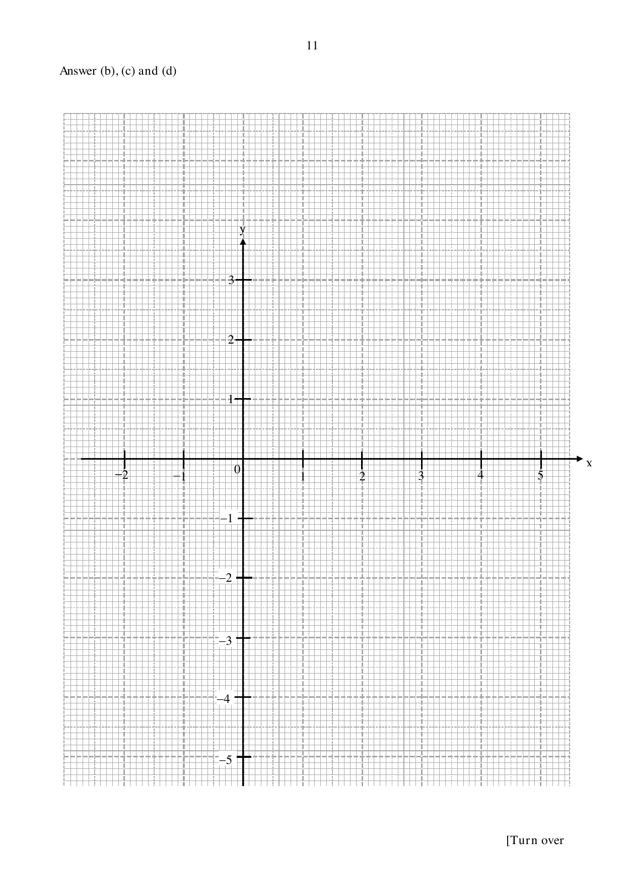
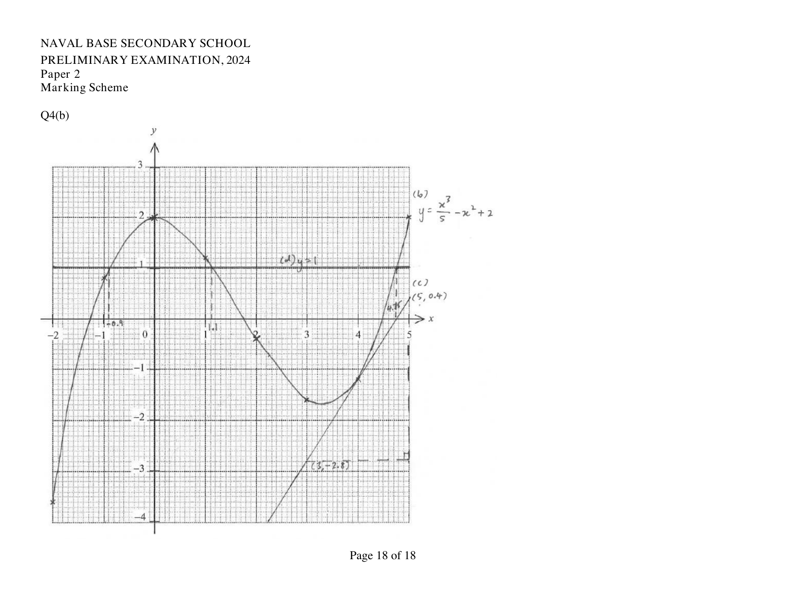

## Question

> **Marks:** (a) [2]; (b) [3]; (c) [2]; (d) [3]; (e) [1]
> **Page:** 10–12

**(a)** Complete the table of values for $y = \dfrac{x^{3}}{5}-x^{2}+2$.

| $x$ | $-2$ | $-1$ | $0$ | $1$ | $2$ | $3$ | $4$ | $5$ |
| --- | --- | --- | --- | --- | --- | --- | --- | --- |
| $y$ | $-3.6$ |  | $2$ | $1.2$ | $-0.4$ | $-1.6$ | $-1.2$ |  |

**(b)** On the grid, draw the graph of $y = \dfrac{x^{3}}{5}-x^{2}+2$ for $-2 \le x \le 5$.

**(c)** By drawing a tangent, find the gradient of the curve at the point when $x = 4$.

**(d)** By drawing a suitable straight line on the grid, solve the equation $\dfrac{x^{3}}{5}-x^{2}+1 = 0$.

**(e)** “$y = k$ will always have exactly three intersections with $y = \dfrac{x^{3}}{5}-x^{2}+2$ when $k$ is negative.”

The above statement is false. Suggest a possible value of $k$.

## Answer Scheme

**(a)** $y = 0.8$ when $x = -1$, and $y = 2$ when $x = 5$.

**(b)** and **(c)** The scheme graph, with the tangent at $x = 4$, is on the last page of the mark scheme.

**(c)** Using $(3, -2.8)$ and $(5, 0.4)$, gradient $= \dfrac{0.4-(-2.8)}{5-3} = 1.6$. Accept $1.1$ to $2.2$.

**(d)** Draw $y = 1$.

$x = -0.9$ (accept $-1.0$ to $-0.8$), or $x = 1.1$ (accept $1.0$ to $1.2$), or $x = 4.75$ (accept $4.6$ to $4.9$).

**(e)** The statement is false for $k < -1.7$. Exactly three intersections when $-1.7 < k < 0$. The remark also says accept all negative values.
