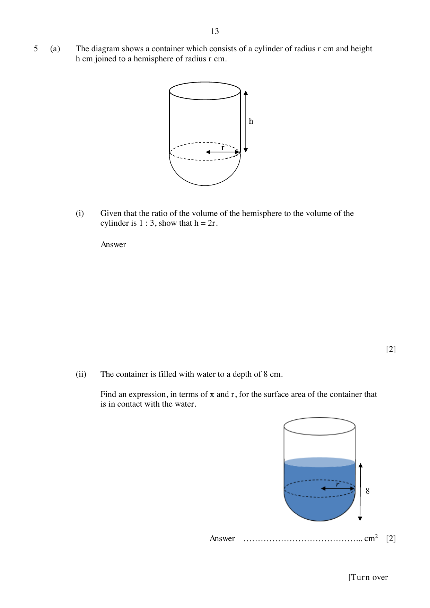
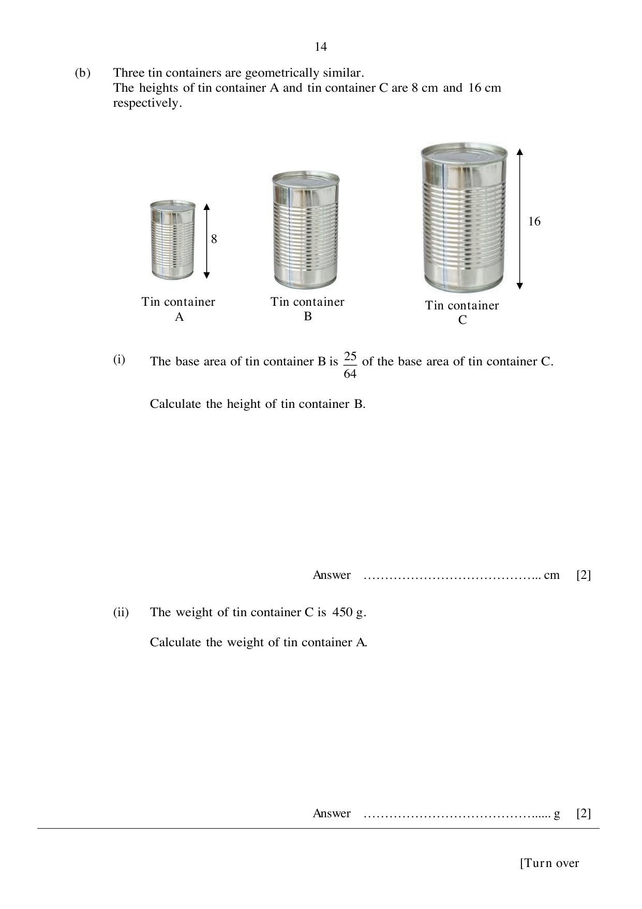

## Question

> **Marks:** (a)(i) [2]; (a)(ii) [2]; (b)(i) [2]; (b)(ii) [2]
> **Page:** 13–14

**(a)** The diagram shows a container which consists of a cylinder of radius $r$ cm and height $h$ cm joined to a hemisphere of radius $r$ cm.

**(i)** Given that the ratio of the volume of the hemisphere to the volume of the cylinder is $1:3$, show that $h = 2r$.

**(ii)** The container is filled with water to a depth of 8 cm.

Find an expression, in terms of $\pi$ and $r$, for the surface area of the container that is in contact with the water.

**(b)** Three tin containers are geometrically similar.
The heights of tin container A and tin container C are 8 cm and 16 cm respectively.

**(i)** The base area of tin container B is $\dfrac{25}{64}$ of the base area of tin container C.

Calculate the height of tin container B.

**(ii)** The weight of tin container C is 450 g.

Calculate the weight of tin container A.

## Answer Scheme

**(a) (i)** $\dfrac{2}{3}\pi r^{3} = \dfrac{1}{3}\pi r^{2}h$, so $h = 2r$.

**(ii)** $2\pi r^{2}+2\pi r(8-r) = 16\pi r$

**(b) (i)** $\dfrac{h_{B}}{16} = \sqrt{\dfrac{25}{64}} = \dfrac{5}{8}$, so $h_{B} = 10$ cm.

**(ii)** $\dfrac{V_{A}}{450} = \left(\dfrac{8}{16}\right)^{3} = \dfrac{1}{8}$, so $V_{A} = 56.25$ g.
