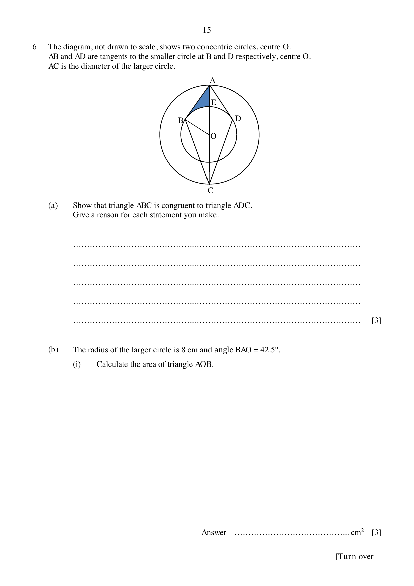

## Question

> **Marks:** (a) [3]; (b)(i) [3]; (b)(ii) [3]
> **Page:** 15–16

The diagram, not drawn to scale, shows two concentric circles, centre $O$.
$AB$ and $AD$ are tangents to the smaller circle at $B$ and $D$ respectively.
$AC$ is the diameter of the larger circle.

**(a)** Show that triangle $ABC$ is congruent to triangle $ADC$.
Give a reason for each statement you make.

**(b)** The radius of the larger circle is 8 cm and angle $BAO = 42.5^{\circ}$.

**(i)** Calculate the area of triangle $AOB$.

**(ii)** Calculate the area of the shaded region.

## Answer Scheme

**(a)** $AB = AD$ (tangents from an external point).

$\angle BAC = \angle DAC$ (tangents from an external point).

$AC$ is common.

$\triangle ABC \equiv \triangle ADC$ (SAS).

**(b) (i)** $\angle ABO = 90^{\circ}$.

$AB = 8\cos 42.5^{\circ} = 5.8982186$ cm.

Area $= \dfrac{1}{2}\times 8\times 5.8982186\times\sin 42.5^{\circ} = 15.9\text{ cm}^{2}$ (3 s.f.).

**(ii)** $\angle AOB = 47.5^{\circ}$ and $OB = 8\sin 42.5^{\circ} = 5.404721$ cm.

Sector $OBE = \dfrac{47.5}{360}\times\pi\times 5.404721^{2} = 12.10842\text{ cm}^{2}$.

Shaded area $= 15.93911-12.10842 = 3.83\text{ cm}^{2}$ (3 s.f.).
