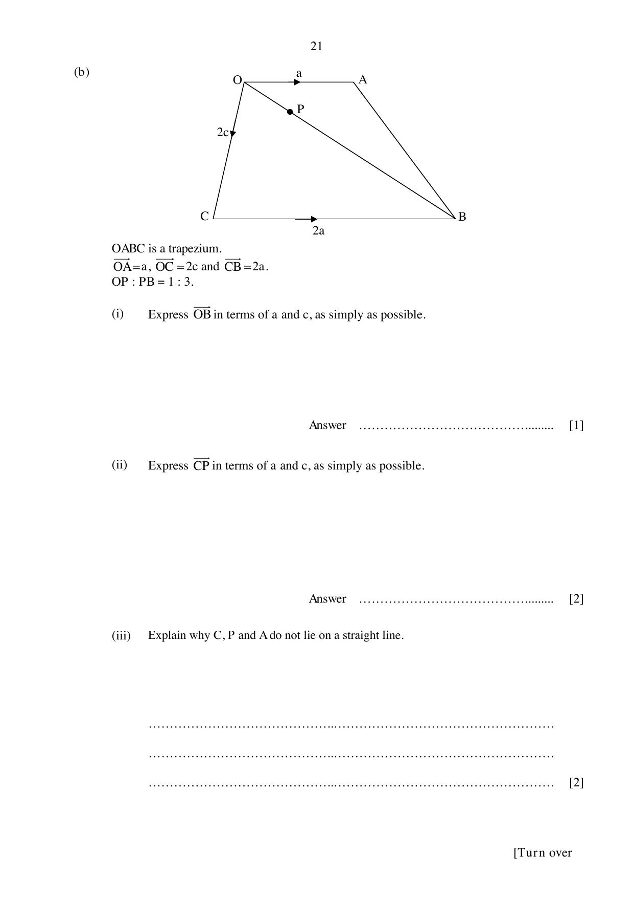

## Question

> **Marks:** (a)(i) [1]; (a)(ii) [1]; (a)(iii) [1]; (a)(iv) [3]; (b)(i) [1]; (b)(ii) [2]; (b)(iii) [2]; (b)(iv) [1]
> **Page:** 20–22

**(a)** $A$ is the point $(1, -4)$ and $B$ is the point $(-7, -2)$.
The point $C$ is the result of the translation of point $B$ by $\begin{pmatrix} 5 \\ 4 \end{pmatrix}$.

**(i)** Find the length of $AB$.

**(ii)** Write down the column vector $\overrightarrow{AB}$.

**(iii)** Find the coordinates of point $C$.

**(iv)** Find the equation of the line $AC$.

**(b)** $OABC$ is a trapezium.
$\overrightarrow{OA} = \mathbf{a}$, $\overrightarrow{OC} = 2\mathbf{c}$ and $\overrightarrow{CB} = 2\mathbf{a}$.
$OP:PB = 1:3$.

**(i)** Express $\overrightarrow{OB}$ in terms of $\mathbf{a}$ and $\mathbf{c}$, as simply as possible.

**(ii)** Express $\overrightarrow{CP}$ in terms of $\mathbf{a}$ and $\mathbf{c}$, as simply as possible.

**(iii)** Explain why $C$, $P$ and $A$ do not lie on a straight line.

**(iv)** Write down the value of $\dfrac{\text{area of triangle } OBC}{\text{area of trapezium } OABC}$.

## Answer Scheme

**(a) (i)** $AB = \sqrt{(1-(-7))^{2}+(-4-(-2))^{2}} = \sqrt{68} = 8.25$ units (3 s.f.).

**(ii)** $\overrightarrow{AB} = \begin{pmatrix} -8 \\ 2 \end{pmatrix}$

**(iii)** $C(-2, 2)$

**(iv)** Gradient $= \dfrac{-4-2}{1-(-2)} = -2$.

$y = -2x-2$.

**(b) (i)** $\overrightarrow{OB} = 2\mathbf{a}+2\mathbf{c}$

**(ii)** $\overrightarrow{CP} = -\dfrac{3}{2}\mathbf{c}+\dfrac{1}{2}\mathbf{a}$

**(iii)** $\overrightarrow{CA} = -2\mathbf{c}+\mathbf{a}$, which is not a scalar multiple of $\overrightarrow{CP}$, so $C$, $P$ and $A$ are not collinear.

**(iv)** $\dfrac{2}{3}$
