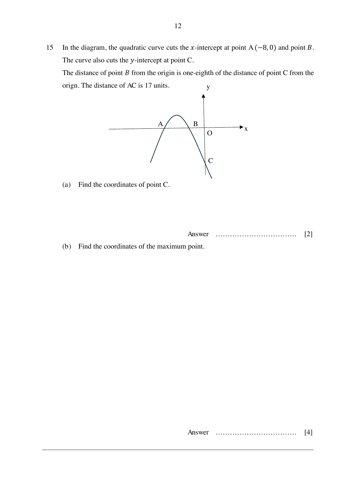

## Question

> **Marks:** (a) [2]; (b) [4]
> **Page:** 12

In the diagram, the quadratic curve cuts the $x$-intercept at point $A(-8, 0)$ and point $B$.
The curve also cuts the $y$-intercept at point $C$.
The distance of point $B$ from the origin is one-eighth of the distance of point $C$ from the origin. The distance of $AC$ is 17 units.

**(a)** Find the coordinates of point $C$.

**(b)** Find the coordinates of the maximum point.

## Answer Scheme

**(a)** Let the $y$-intercept (vertical distance) be $d$.

By Pythagoras’ theorem,

$$
\begin{aligned}
d &= \sqrt{17^{2}-8^{2}} \\
d &= 15 \\
\therefore C(0, -15)
\end{aligned}
$$

**(b)** Let the $x$-coordinate of point $B$ be $b$.

$$
\begin{aligned}
b &= \frac{1}{8}(-15) \\
b &= -\frac{15}{8}
\end{aligned}
$$

Equation of the line of symmetry:

$$
x = \frac{-\dfrac{15}{8}+(-8)}{2} = -\frac{79}{16}
$$

Since $y = -15$ when $x = 0$, the coefficient of $x^{2}$ is $-1$.

$$
y = -\left(x+8\right)\left(x+\frac{15}{8}\right) \quad\text{or}\quad y = -\frac{1}{8}(x+8)(8x+15)
$$

$$
\begin{aligned}
y &= -\left(-\frac{79}{16}+8\right)\left(-\frac{79}{16}+\frac{15}{8}\right) \\
&= \frac{2401}{256}
\end{aligned}
$$

The coordinate of the maximum point is $\left(-\dfrac{79}{16}, \dfrac{2401}{256}\right)$ or $(-4.94, 9.38)$.
