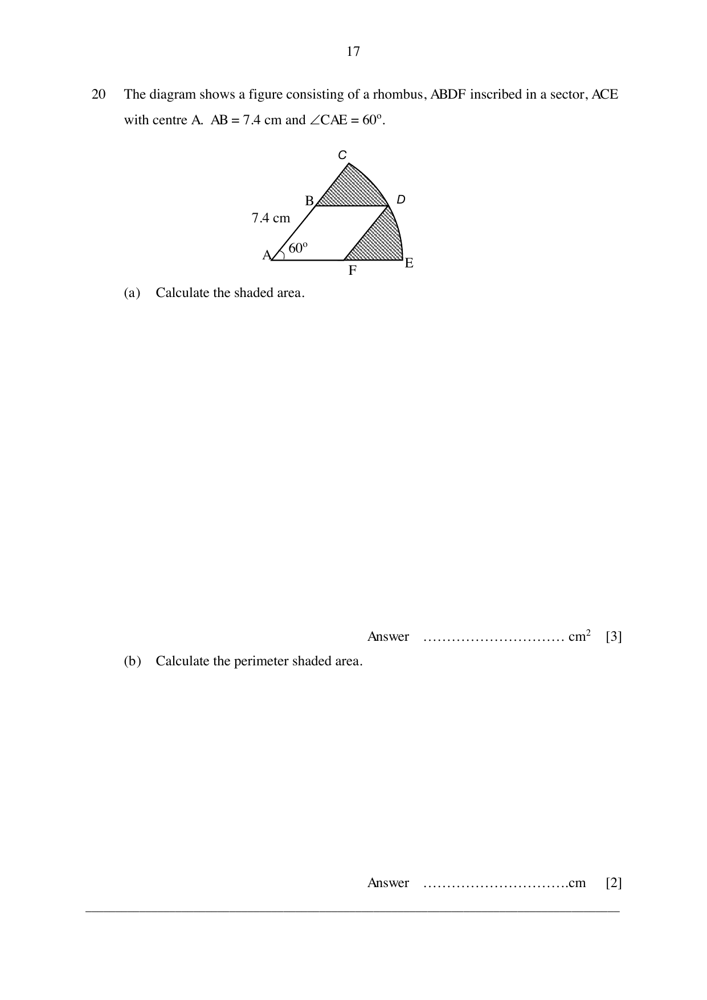

## Question

> **Marks:** (a) [3]; (b) [2]
> **Page:** 17

The diagram shows a figure consisting of a rhombus, $ABDF$ inscribed in a sector, $ACE$ with centre $A$. $AB = 7.4$ cm and $\angle CAE = 60^{\circ}$.

**(a)** Calculate the shaded area.

**(b)** Calculate the perimeter shaded area.

## Answer Scheme

**(a)**

$$
\begin{aligned}
\text{Area of rhombus} &= 2\times\frac{1}{2}(7.4)(7.4)\sin 60^{\circ} \\
&= 47.424\text{ cm}^{2}
\end{aligned}
$$

Or height of rhombus $= (7.4)(\sin 60^{\circ}) = 6.4086$ cm, so area $= (6.4086)(7.4) = 47.424\text{ cm}^{2}$.

$$
\begin{aligned}
AD^{2} &= 7.4^{2}+7.4^{2}-2(7.4)(7.4)\cos 120^{\circ} \\
AD &= 12.817\text{ cm} \\
\text{Area of sector} &= \frac{60}{360}\times\pi(12.817)^{2} = 86.014\text{ cm}^{2} \\
\text{Shaded area} &= 86.014-47.424 = 38.6\text{ cm}^{2}
\end{aligned}
$$

**(b)**

$$
\begin{aligned}
\text{Arc length} &= \frac{60}{360}\times 2\pi(12.817) = 13.422 \\
\text{Perimeter} &= 13.422+2(12.817-7.4)+2(7.4) = 39.1\text{ cm}
\end{aligned}
$$
