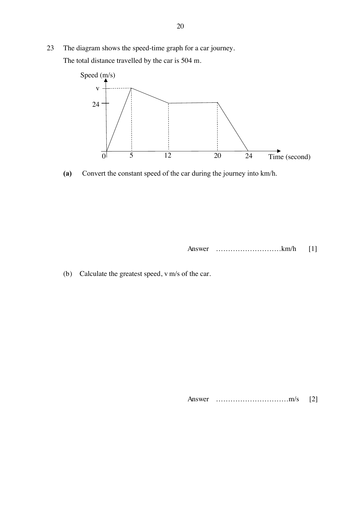
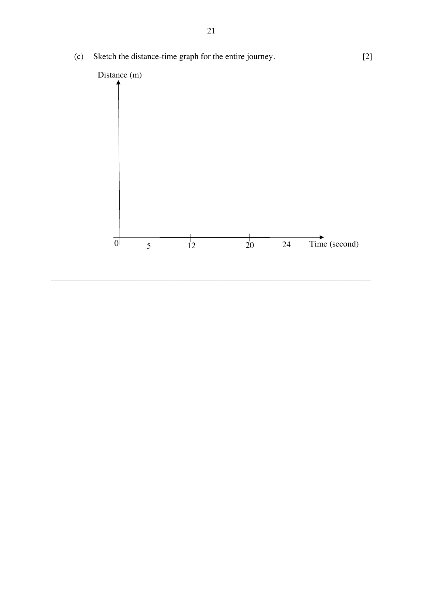

## Question

> **Marks:** (a) [1]; (b) [2]; (c) [2]
> **Page:** 20–21

The diagram shows the speed-time graph for a car journey.
The total distance travelled by the car is 504 m.

**(a)** Convert the constant speed of the car during the journey into km/h.

**(b)** Calculate the greatest speed, $v$ m/s of the car.

**(c)** Sketch the distance-time graph for the entire journey.

## Answer Scheme

**(a)**

$$
24\text{ m/s} = \frac{24\times\dfrac{1}{1000}\text{ km}}{1\times\dfrac{1}{3600}\text{ h}} = 86.4\text{ km/h}
$$

**(b)** Printed working:

$$
\begin{aligned}
504 &= \left(\frac{1}{2}\times 5\times v\right)+\left(\frac{1}{2}(v+24)(7)\right)+\left(\frac{1}{2}(8+12)(24)\right) \\
504 &= \frac{5}{2}v+\frac{7}{2}v+84+240 \\
180 &= 6v \\
v &= 30\text{ km/h}
\end{aligned}
$$

**(c)**

Distance from 0 s to 5 s $= \dfrac{1}{2}\times 5\times 30 = 75$ m.

Distance from 0 s to 12 s $= 75+\dfrac{1}{2}(30+24)(7) = 264$ m.

Distance from 0 s to 20 s $= 264+(24)(8) = 456$ m.

