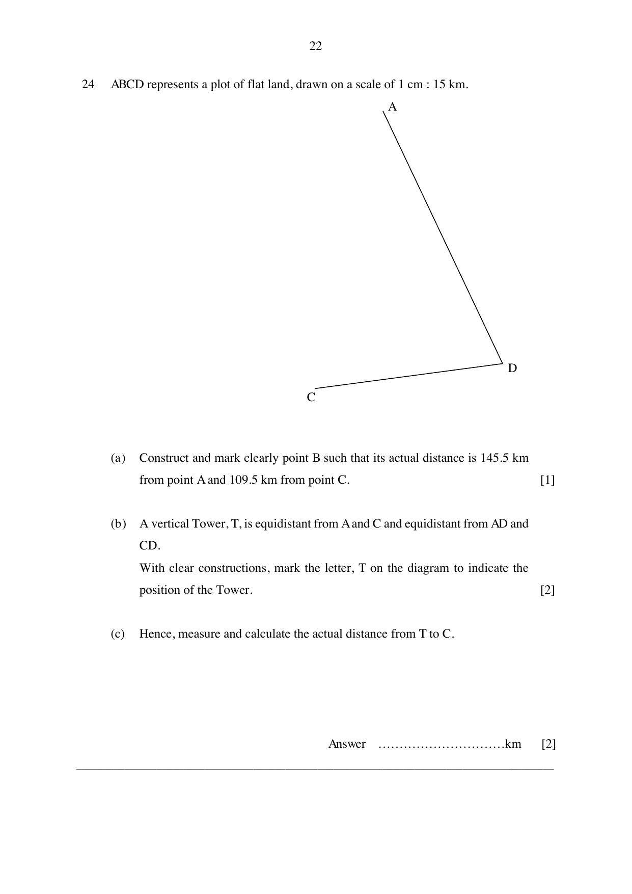

## Question

> **Marks:** (a) [1]; (b) [2]; (c) [2]
> **Page:** 22

$ABCD$ represents a plot of flat land, drawn on a scale of 1 cm : 15 km.

**(a)** Construct and mark clearly point $B$ such that its actual distance is 145.5 km from point $A$ and 109.5 km from point $C$.

**(b)** A vertical Tower, $T$, is equidistant from $A$ and $C$ and equidistant from $AD$ and $CD$.
With clear constructions, mark the letter, $T$ on the diagram to indicate the position of the Tower.

**(c)** Hence, measure and calculate the actual distance from $T$ to $C$.

## Answer Scheme

**(a)** and **(b)** Construction: $145.5\text{ km}\to 9.7\text{ cm}$ and $109.5\text{ km}\to 7.3\text{ cm}$. Point $B$ is the intersection of those arcs. $T$ is the intersection of the perpendicular bisector of $AC$ and the angle bisector of $\angle ADC$.

**(c)** $5.9\times 15 = 88.5$ km.
