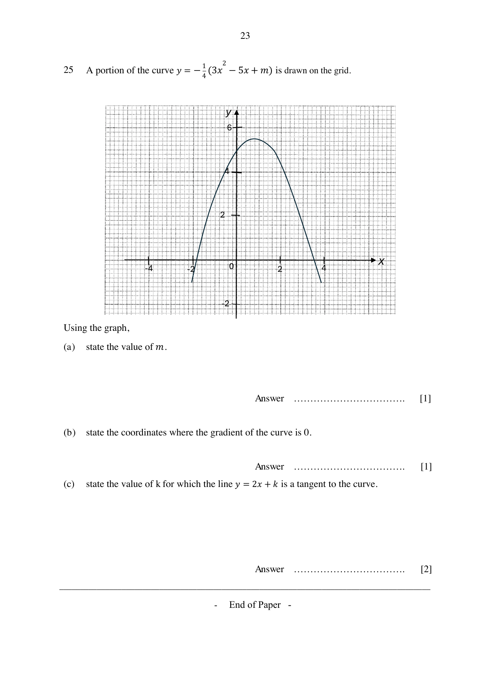

## Question

> **Marks:** (a) [1]; (b) [1]; (c) [2]
> **Page:** 23

A portion of the curve $y = -\dfrac{1}{4}(3x^{2}-5x+m)$ is drawn on the grid.

Using the graph,

**(a)** state the value of $m$.

**(b)** state the coordinates where the gradient of the curve is 0.

**(c)** state the value of $k$ for which the line $y = 2x+k$ is a tangent to the curve.

## Answer Scheme

**(a)** $-20$

**(b)** $(0.8, 5.5)$

**(c)** $k = 5.2$. The tangent of gradient 2 is drawn on the graph in the image above.
