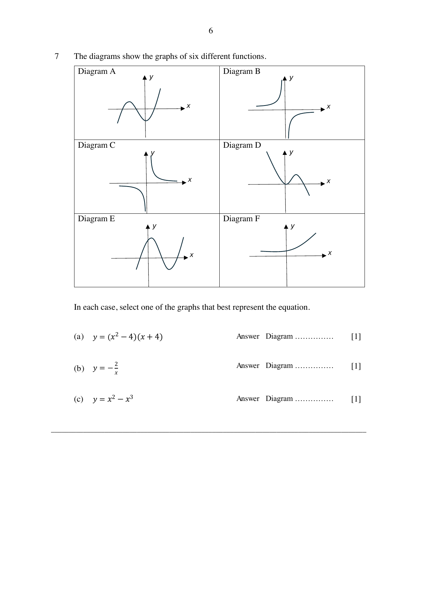

## Question

> **Marks:** (a) [1]; (b) [1]; (c) [1]
> **Page:** 6

The diagrams show the graphs of six different functions.

In each case, select one of the graphs that best represent the equation.

**(a)** $y = (x^{2}-4)(x+4)$

**(b)** $y = -\dfrac{2}{x}$

**(c)** $y = x^{2}-x^{3}$

## Answer Scheme

**(a)** Diagram A

**(b)** Diagram B

**(c)** Diagram D
