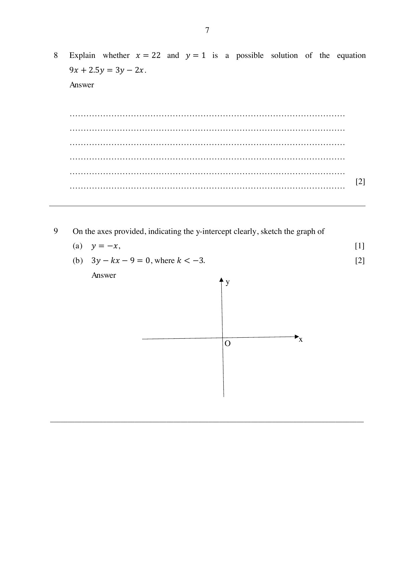

## Question

> **Marks:** (a) [1]; (b) [2]
> **Page:** 7

On the axes provided, indicating the $y$-intercept clearly, sketch the graph of

**(a)** $y = -x$,

**(b)** $3y-kx-9 = 0$, where $k < -3$.

## Answer Scheme

**(a)** The line $y = -x$ passes through the origin with gradient $-1$.

**(b)**

$$
\begin{aligned}
3y-kx-9 &= 0 \\
3y &= kx+9 \\
y &= \frac{k}{3}x+3,\text{ where }k < -3
\end{aligned}
$$

The line has $y$-intercept $3$ and a negative gradient steeper than $-1$.
