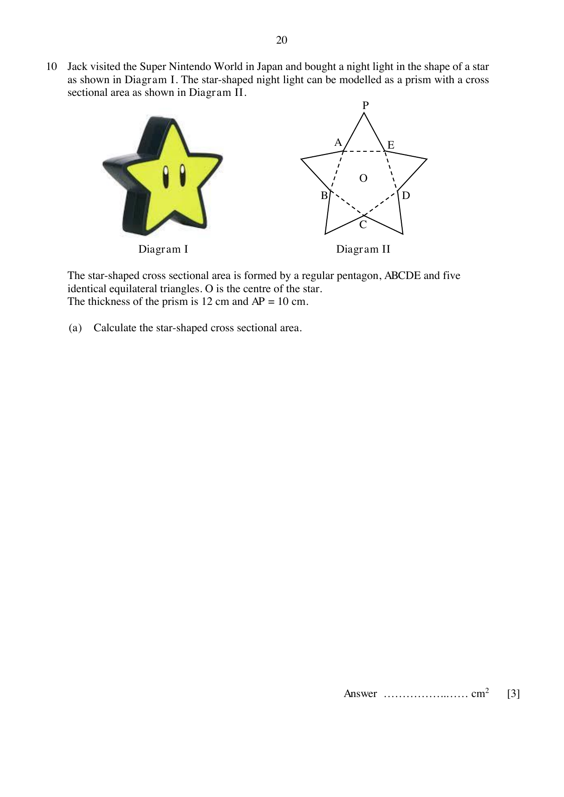
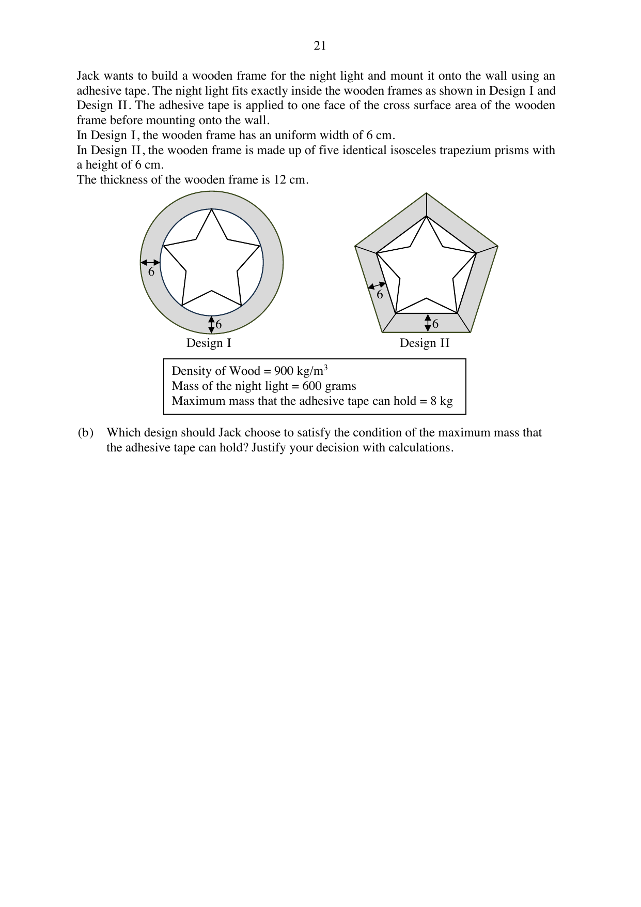

## Question

> **Marks:** (a) [3]; (b) [7]
> **Page:** 20–22

Jack visited the Super Nintendo World in Japan and bought a night light in the shape of a star as shown in Diagram I. The star-shaped night light can be modelled as a prism with a cross sectional area as shown in Diagram II.

The star-shaped cross sectional area is formed by a regular pentagon, $ABCDE$ and five identical equilateral triangles. $O$ is the centre of the star.
The thickness of the prism is 12 cm and $AP = 10$ cm.

**(a)** Calculate the star-shaped cross sectional area.

Jack wants to build a wooden frame for the night light and mount it onto the wall using an adhesive tape. The night light fits exactly inside the wooden frames as shown in Design I and Design II. The adhesive tape is applied to one face of the cross surface area of the wooden frame before mounting onto the wall.
In Design I, the wooden frame has a uniform width of 6 cm.
In Design II, the wooden frame is made up of five identical isosceles trapezium prisms with a height of 6 cm.
The thickness of the wooden frame is 12 cm.

Density of wood $= 900\text{ kg/m}^{3}$.
Mass of the night light $= 600$ grams.
Maximum mass that the adhesive tape can hold $= 8$ kg.

**(b)** Which design should Jack choose to satisfy the condition of the maximum mass that the adhesive tape can hold? Justify your decision with calculations.

## Answer Scheme

**(a)** Method 1.

$$
\begin{aligned}
h_{1} &= 10\sin 60^{\circ} = 8.6603 \\
h_{2} &= 5\tan 54^{\circ} = 6.8819 \\
\text{Area} &= 10\times\frac{1}{2}\times 15.5422\times 5 = 388.555 = 389\text{ cm}^{2}\text{ (3 s.f.)}
\end{aligned}
$$

**(b)** Density $= 900\text{ kg/m}^{3} = 0.9\text{ g/cm}^{3}$.

Design I. Outer radius $= 15.5422+6 = 21.5422$.

Cross-sectional area $= \pi(21.5422)^{2}-\pi(15.5422)^{2} = 699.024\text{ cm}^{2}$.

Volume $= 8388.288\text{ cm}^{3}$. Mass of wood $= 7549.4592$ g. Total mass $= 8149.4592$ g.

Design II. $l = \dfrac{6}{\cos 36^{\circ}} = 7.4164$.

Cross-sectional area $= 678.905\text{ cm}^{2}$. Volume $= 8146.86\text{ cm}^{3}$. Mass of wood $= 7332.174$ g. Total mass $= 7932.174$ g.

Since $7932.174 < 8000 < 8149.4592$ grams, Jack should choose Design II.
