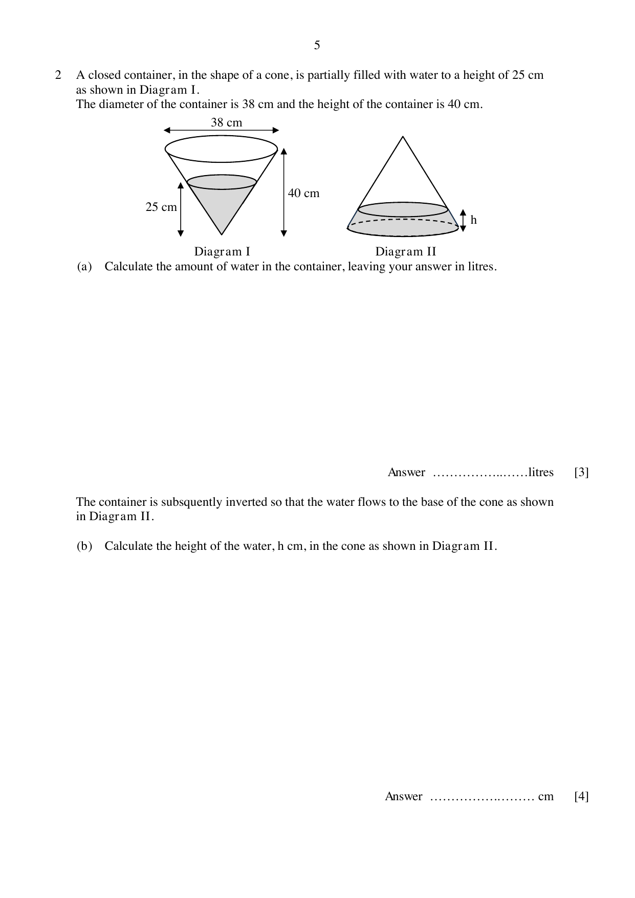

## Question

> **Marks:** (a) [3]; (b) [4]
> **Page:** 5

A closed container, in the shape of a cone, is partially filled with water to a height of 25 cm as shown in Diagram I.
The diameter of the container is 38 cm and the height of the container is 40 cm.

**(a)** Calculate the amount of water in the container, leaving your answer in litres.

The container is subsequently inverted so that the water flows to the base of the cone as shown in Diagram II.

**(b)** Calculate the height of the water, $h$ cm, in the cone as shown in Diagram II.

## Answer Scheme

**(a)**

$$
\begin{aligned}
\frac{r}{19} &= \frac{25}{40} \\
r &= \frac{25}{40}\times 19 = 11.875 \\
V &= \frac{1}{3}\pi(11.875)^{2}(25) = 3691.78\text{ cm}^{3} = 3.69\text{ litres}
\end{aligned}
$$

**(b)** Method 1. Volume of container $= \dfrac{1}{3}\pi(19)^{2}(40)$.

$$
\begin{aligned}
\left(\frac{h_{1}}{40}\right)^{3} &= \frac{\dfrac{1}{3}\pi(19)^{2}(40)-\dfrac{1}{3}\pi(11.875)^{2}(25)}{\dfrac{1}{3}\pi(19)^{2}(40)} \\
h_{1} &= 40\times\sqrt[3]{\frac{(19)^{2}(40)-(11.875)^{2}(25)}{(19)^{2}(40)}} = 36.437 \\
\text{Depth of water} &= 40-36.437 = 3.56\text{ cm (3 s.f.)}
\end{aligned}
$$

Method 2 reaches the same depth, $3.56$ cm.
