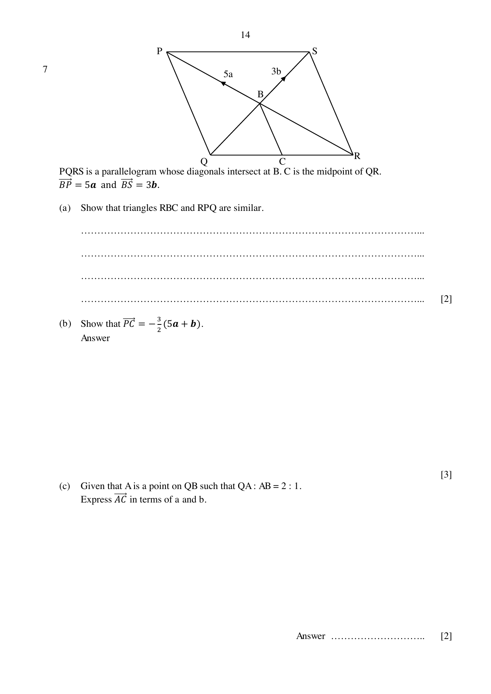

## Question

> **Marks:** (a) [2]; (b) [3]; (c) [2]; (d) [1]; (e) [2]; (f)(i) [1]; (f)(ii) [2]
> **Page:** 14–15

$PQRS$ is a parallelogram whose diagonals intersect at $B$. $C$ is the midpoint of $QR$.
$\overrightarrow{BP} = 5\mathbf{a}$ and $\overrightarrow{BS} = 3\mathbf{b}$.

**(a)** Show that triangles $RBC$ and $RPQ$ are similar.

**(b)** Show that $\overrightarrow{PC} = -\dfrac{3}{2}(5\mathbf{a}+\mathbf{b})$.

**(c)** Given that $A$ is a point on $QB$ such that $QA:AB = 2:1$.
Express $\overrightarrow{AC}$ in terms of $\mathbf{a}$ and $\mathbf{b}$.

**(d)** State one fact about $P$, $A$ and $C$.

**(e)** Explain why the areas of triangle $PAB$ and triangle $QAC$ are equal.

**(f)** Find

**(i)** $\dfrac{\text{area of }\triangle ABC}{\text{area of }\triangle QBC}$,

**(ii)** $\dfrac{\text{area of }\triangle ABC}{\text{area of }\triangle RPQ}$.

## Answer Scheme

**(a)** Method 1. $\angle BRC = \angle PRQ$ (common angle).

$\dfrac{CR}{QR} = \dfrac{1}{2}$ ($C$ is the midpoint of $QR$).

$\dfrac{BR}{PR} = \dfrac{1}{2}$ (diagonals of a parallelogram bisect each other).

$\triangle RBC$ and $\triangle RPQ$ are similar (SAS similarity).

Method 2 uses the midpoint theorem so $BC\parallel PQ$, then AA similarity.

**(b)**

$$
\begin{aligned}
\overrightarrow{PC} &= \overrightarrow{PQ}+\overrightarrow{QC} \\
&= (\overrightarrow{PB}+\overrightarrow{BQ})+\frac{1}{2}\overrightarrow{QR} \\
&= -5\mathbf{a}-3\mathbf{b}+\frac{1}{2}(-5\mathbf{a}+3\mathbf{b}) \\
&= -\frac{15}{2}\mathbf{a}-\frac{3}{2}\mathbf{b} \\
&= -\frac{3}{2}(5\mathbf{a}+\mathbf{b})
\end{aligned}
$$

**(c)** $QA:AB = 2:1$, so $\overrightarrow{AQ} = -2\mathbf{b}$.

$$
\overrightarrow{AC} = -2\mathbf{b}+\frac{1}{2}(-5\mathbf{a}+3\mathbf{b}) = -\frac{5}{2}\mathbf{a}-\frac{1}{2}\mathbf{b} = -\frac{1}{2}(5\mathbf{a}+\mathbf{b})
$$

**(d)** $\overrightarrow{PC} = 3\overrightarrow{AC}$. Since $C$ is common, $P$, $A$ and $C$ are collinear.

**(e)** $\angle PAB = \angle QAC$ (vertically opposite angles), $\dfrac{AB}{QA} = \dfrac{1}{2}$ and $\dfrac{PA}{AC} = \dfrac{2}{1}$, so

$$
\frac{\text{area }\triangle PAB}{\text{area }\triangle QAC} = 1.
$$

**(f) (i)** $\dfrac{1}{3}$

**(ii)** $\dfrac{1}{3}\times 1\times\left(\dfrac{1}{2}\right)^{2} = \dfrac{1}{12}$
