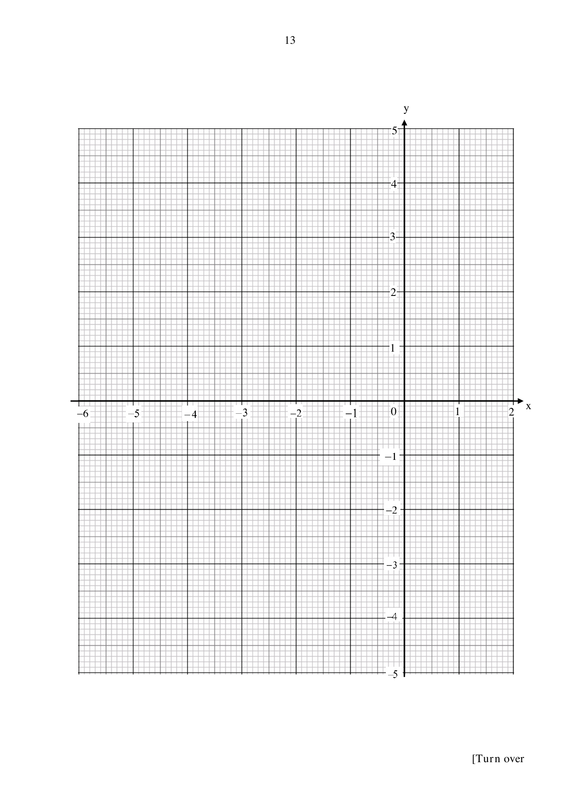

## Question

> **Marks:** (a) 1, (b) 3, (c) 2, (d) 3, (e) 2; total 11
> **Page:** 12–13

**(a)** Complete the table of values for $y=\dfrac{1}{4}x^{3}+\dfrac{3}{2}x^{2}-4$.

| $x$ | $-6$ | $-5$ | $-4$ | $-3$ | $-2$ | $-1$ | $0$ | $1$ | $2$ |
| --- | --- | --- | --- | --- | --- | --- | --- | --- | --- |
| $y$ | | $2.25$ | $4$ | $2.75$ | $0$ | $-2.75$ | $-4$ | $-2.25$ | $4$ |

**(b)** On the grid, draw the graph of $y=\dfrac{1}{4}x^{3}+\dfrac{3}{2}x^{2}-4$ for $-6 \le x \le 2$.

**(c)** The equation $\dfrac{1}{4}x^{3}+\dfrac{3}{2}x^{2}-4=k$ has no solution. Use your graph to find 2 possible integer values of $k$.

**(d)** By drawing a suitable line on the grid, solve the equation $x^{3}+6x^{2}-2x-16=0$.

**(e)** By drawing a tangent, find the gradient of the curve at $(1, -2.25)$.

## Answer Scheme

**(a)** When $x=-6$, $y=-4$ B1

**(b)** Plot all 9 points. P2 if all 9 are correct, P1 if 7 or 8 are correct. C1 for a smooth curve through at least 7 points. Tolerate 1 mm.

**(c)** $k=-5$ or $k=5$ B2

**(d)** Divide $x^{3}+6x^{2}-2x-16=0$ by 4:

$$
\frac{1}{4}x^{3}+\frac{3}{2}x^{2}-4=\frac{1}{2}x
$$

M1

Draw the line $y=\dfrac{1}{2}x$ and label its equation. M1

$x=-5.85$, $-1.7$, $1.6$ ($\pm 0.1$) A1

**(e)** Gradient $=3.75$ ($\pm 0.5$) M1 for the tangent, A1
