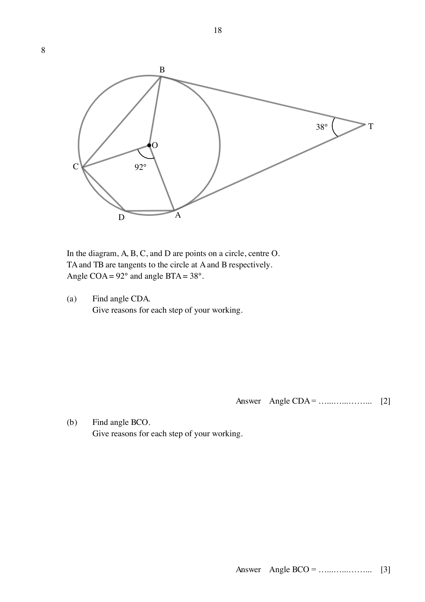

## Question

> **Marks:** (a) 2, (b) 3, (c) 4; total 9
> **Page:** 18–19

In the diagram, $A$, $B$, $C$, and $D$ are points on a circle, centre $O$.
$TA$ and $TB$ are tangents to the circle at $A$ and $B$ respectively.
Angle $COA=92^{\circ}$ and angle $BTA=38^{\circ}$.

**(a)** Find angle $CDA$.
Give reasons for each step of your working.

**(b)** Find angle $BCO$.
Give reasons for each step of your working.

**(c)** The radius of the circle is 7 cm.
Find the area enclosed by $TA$, $TB$ and major arc $BCDA$.

## Answer Scheme

**(a)** Reflex $\angle COA=360-92=268^{\circ}$ (angles at a point) M1

$\angle CDA=\dfrac{268}{2}=134^{\circ}$ (angle at the centre is twice the angle at the circumference) A1

Alternative: $\angle CBA=\dfrac{92}{2}=46^{\circ}$, then $\angle CDA=180-46=134^{\circ}$ (angles in opposite segments).

**(b)** $\angle OBT=\angle OAT=90^{\circ}$ (tangent perpendicular to radius)

$\angle AOB=360-90-90-38=142^{\circ}$ (angle sum of a quadrilateral) M1

$\angle BOC=360-92-142=126^{\circ}$ (angles at a point) M1

$\angle BCO=\dfrac{180-126}{2}=27^{\circ}$ (base angles of an isosceles triangle) A1

At most 1 mark if two or more reasons are incorrect or missing.

**(c)** $\tan 19^{\circ}=\dfrac{7}{BT}$, so $BT=\dfrac{7}{\tan 19^{\circ}}=20.329\text{ cm}$ M1

Area of quadrilateral $TBOA=2\times\dfrac{1}{2}\times 20.329\times 7=142.306\text{ cm}^{2}$ M1

Area of major sector $=\dfrac{92+126}{360}\times\pi\times 7^{2}=93.218\text{ cm}^{2}$ M1

Required area $=142.306+93.218=235.524=236\text{ cm}^{2}$ A1
