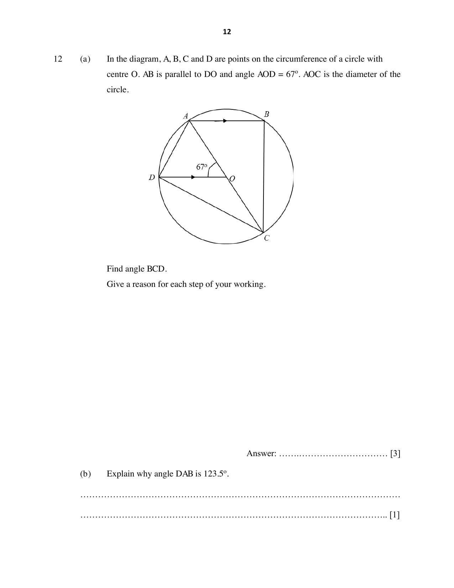

## Question

> **Marks:** (a) 3, (b) 1, (c) 2; total 6
> **Page:** 12–13

**(a)** In the diagram, $A$, $B$, $C$ and $D$ are points on the circumference of a circle with centre $O$. $AB$ is parallel to $DO$ and angle $AOD=67^{\circ}$. $AOC$ is the diameter of the circle.

Find angle $BCD$.
Give a reason for each step of your working.

**(b)** Explain why angle $DAB$ is $123.5^{\circ}$.

**(c)** Find angle $DBC$.
Give a reason for each step of your working.

## Answer Scheme

**(a)** Angle $ACD=\dfrac{67^{\circ}}{2}=33.5^{\circ}$ (angle at the centre is twice the angle at the circumference).

Angle $BAO=67^{\circ}$ (alternate angles, $AB\parallel DO$).

Angle $BCA=180^{\circ}-67^{\circ}-90^{\circ}=23^{\circ}$ (angle in a semicircle).

Angle $BCD=23^{\circ}+33.5^{\circ}=56.5^{\circ}$.

**(b)** Angle $DAB$ and angle $DCB$ are angles in opposite segments and add up to $180^{\circ}$.

**(c)** Angle $DBA=$ angle $DCA=33.5^{\circ}$ (angles in the same segment).

Angle $DBC=90^{\circ}-33.5^{\circ}=56.5^{\circ}$ (angle in a semicircle).
