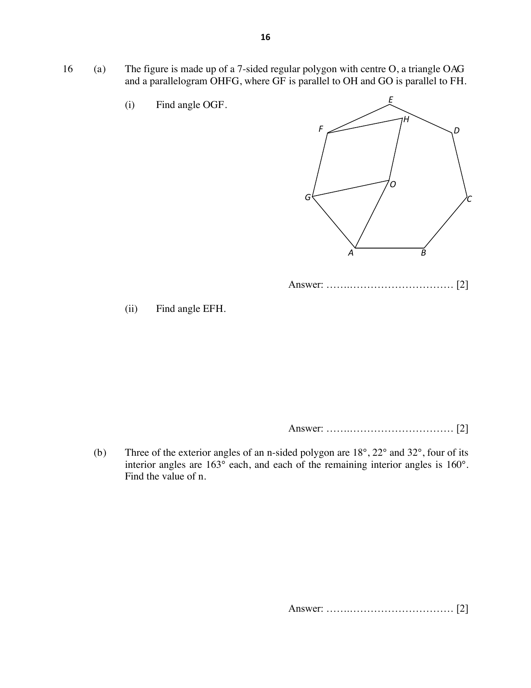

## Question

> **Marks:** (a)(i) 2, (a)(ii) 2, (b) 2; total 6
> **Page:** 16

**(a)** The figure is made up of a 7-sided regular polygon with centre $O$, a triangle $OAG$ and a parallelogram $OHFG$, where $GF$ is parallel to $OH$ and $GO$ is parallel to $FH$.

**(i)** Find angle $OGF$.

**(ii)** Find angle $EFH$.

**(b)** Three of the exterior angles of an $n$-sided polygon are $18^{\circ}$, $22^{\circ}$ and $32^{\circ}$, four of its interior angles are $163^{\circ}$ each, and each of the remaining interior angles is $160^{\circ}$.
Find the value of $n$.

## Answer Scheme

**(a)** **(i)** Interior angle of the regular heptagon $=\dfrac{(7-2)180^{\circ}}{7}=128.57^{\circ}$.

Angle $OGF=128.57^{\circ}\div 2=64.3^{\circ}$.

**(ii)** Angle $GFH=180^{\circ}-64.3^{\circ}=115.7^{\circ}$.

Angle $EFH=128.57^{\circ}-115.7^{\circ}=12.9^{\circ}$.

**(b)** $18+22+32+4(17)+(n-7)(20)=360$

$20n=360$, so $n=18$.
