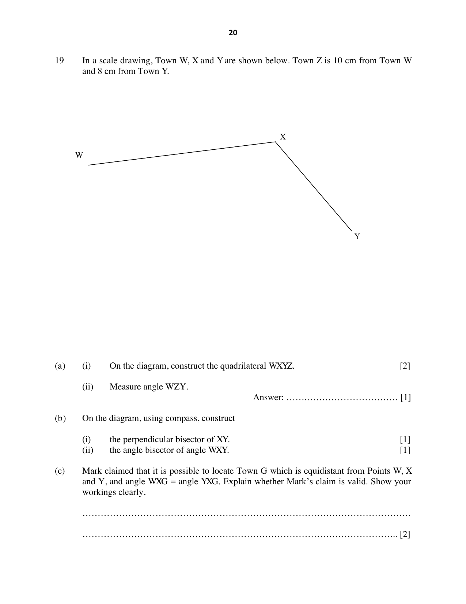

## Question

> **Marks:** (a)(i) 2, (a)(ii) 1, (b)(i) 1, (b)(ii) 1, (c) 2; total 7
> **Page:** 20

In a scale drawing, Town $W$, $X$ and $Y$ are shown below. Town $Z$ is 10 cm from Town $W$ and 8 cm from Town $Y$.

**(a)** **(i)** On the diagram, construct the quadrilateral $WXYZ$.

**(ii)** Measure angle $WZY$.

**(b)** On the diagram, using compass, construct

**(i)** the perpendicular bisector of $XY$,

**(ii)** the angle bisector of angle $WXY$.

**(c)** Mark claimed that it is possible to locate Town $G$ which is equidistant from points $W$, $X$ and $Y$, and angle $WXG$ equals angle $YXG$. Explain whether Mark’s claim is valid. Show your workings clearly.

## Answer Scheme

**(a)** **(ii)** $86^{\circ}$

**(b)** The perpendicular bisector of $XY$ and the angle bisector of angle $WXY$ are drawn on the diagram. $Z$ is constructed 10 cm from $W$ and 8 cm from $Y$.

**(c)** It is not possible. The perpendicular bisector of $WX$, the perpendicular bisector of $XY$, and the angle bisector of angle $WXY$ do not meet at a single point.
