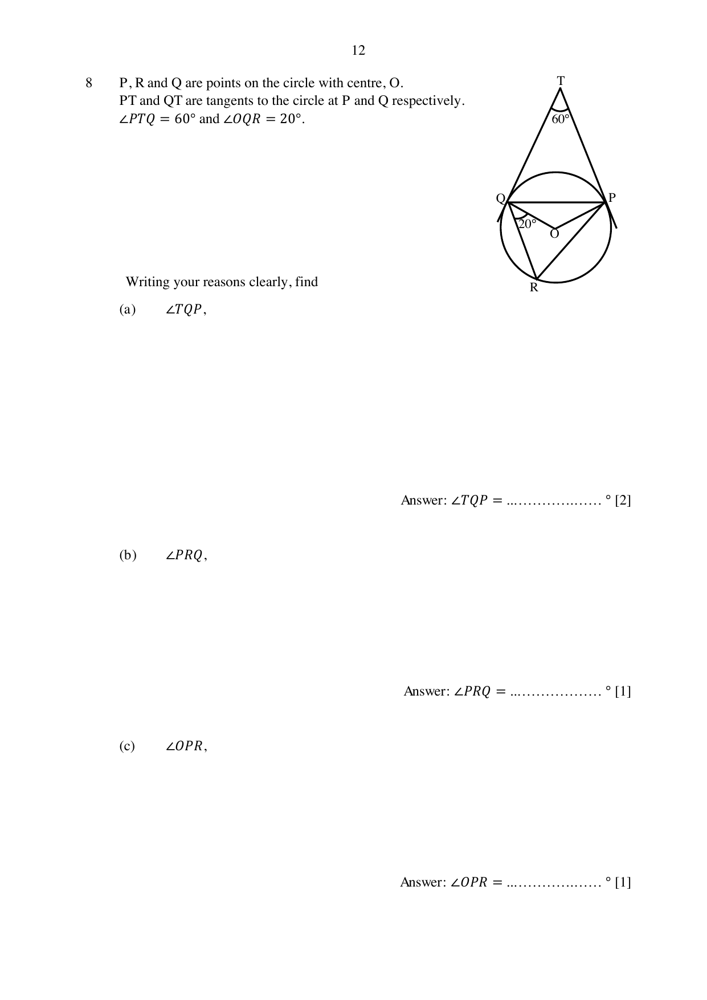

## Question

> **Marks:** (a) 2, (b) 1, (c) 1, (d) 3; total 7
> **Page:** 12–13

$P$, $R$ and $Q$ are points on the circle with centre $O$.
$PT$ and $QT$ are tangents to the circle at $P$ and $Q$ respectively.
$\angle PTQ=60^{\circ}$ and $\angle OQR=20^{\circ}$.

Writing your reasons clearly, find

**(a)** $\angle TQP$,

**(b)** $\angle PRQ$,

**(c)** $\angle OPR$,

**(d)** If the radius of the circle is 5 cm, find the area of the major segment $QRP$ of the circle.

## Answer Scheme

**(a)** $\angle POQ=180^{\circ}-60^{\circ}=120^{\circ}$

$\angle OQP=\dfrac{180^{\circ}-120^{\circ}}{2}=30^{\circ}$ (base angles of an isosceles triangle)

$\angle TQP=90^{\circ}-30^{\circ}=60^{\circ}$

**(b)** $\angle PRQ=\dfrac{120^{\circ}}{2}=60^{\circ}$ (angle at the centre is twice the angle at the circumference)

**(c)** $\angle OPR=180^{\circ}-60^{\circ}-20^{\circ}-(2\times 30^{\circ})=40^{\circ}$ (angle sum of a triangle)

**(d)** Obtuse $\angle QOP=360^{\circ}-120^{\circ}=240^{\circ}$

Major sector $=\dfrac{240}{360}\pi(5)^{2}=\dfrac{50}{3}\pi\text{ cm}^{2}$

Area of $\triangle POQ=\dfrac{1}{2}(5)(5)\sin 120^{\circ}=10.825$

Total area $=63.2\text{ cm}^{2}$
