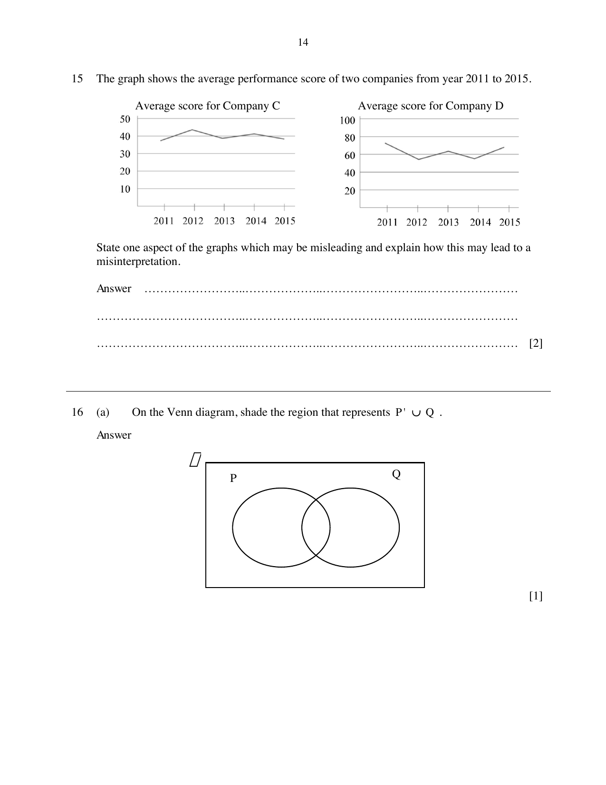

## Question

> **Marks:** 2
> **Page:** 14

The graph shows the average performance score of two companies from year 2011 to 2015.

State one aspect of the graphs which may be misleading and explain how this may lead to a misinterpretation.

## Answer Scheme

The scale on the vertical axis is different and misleading.
It can be misinterpreted that the average score for Company C is higher than Company D.
