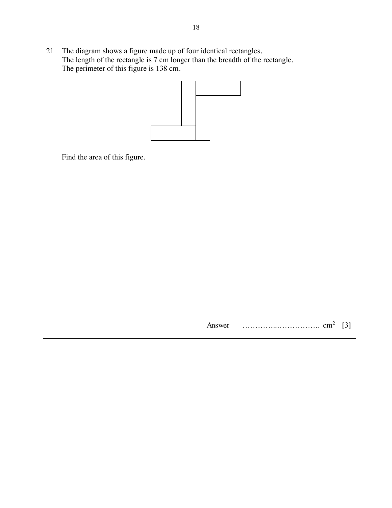

## Question

> **Marks:** 3
> **Page:** 18

The diagram shows a figure made up of four identical rectangles.
The length of the rectangle is 7 cm longer than the breadth of the rectangle.
The perimeter of this figure is 138 cm.

Find the area of this figure.

## Answer Scheme

Breadth $x$ cm, length $x+7$ cm.

$2[(2x+14)+(2x+7)]=138$, so $x=12$

Area $=4\times 12\times 19=912\text{ cm}^{2}$
