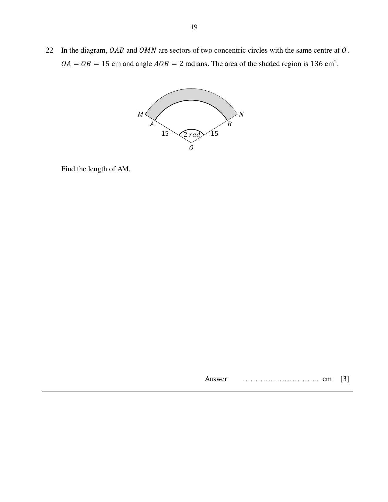

## Question

> **Marks:** 3
> **Page:** 19

In the diagram, $OAB$ and $OMN$ are sectors of two concentric circles with the same centre at $O$.
$OA=OB=15\text{ cm}$ and angle $AOB=2$ radians. The area of the shaded region is $136\text{ cm}^{2}$.

Find the length of $AM$.

## Answer Scheme

Let $AM=x$ cm.

$$
\frac{1}{2}(15+x)^{2}(2)-\frac{1}{2}(15)^{2}(2)=136
$$

$x^{2}+30x-136=0$

$x=-34$ (rejected) or $x=4$
