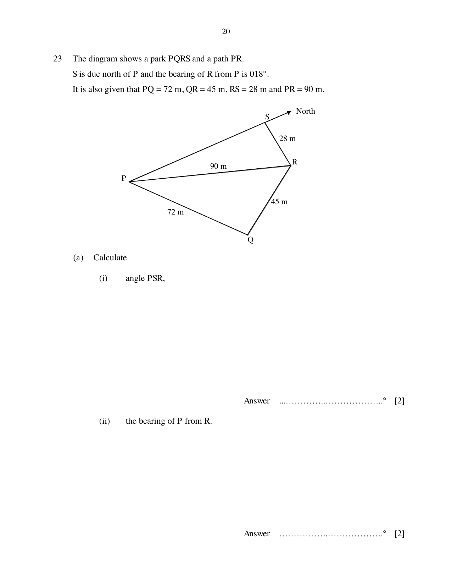

## Question

> **Marks:** (a)(i) 2, (a)(ii) 2, (b) 3, (c)(i) 2, (c)(ii) 1, (d) 2; total 12
> **Page:** 20–21

The diagram shows a park $PQRS$ and a path $PR$.
$S$ is due north of $P$ and the bearing of $R$ from $P$ is $018^{\circ}$.
It is also given that $PQ=72\text{ m}$, $QR=45\text{ m}$, $RS=28\text{ m}$ and $PR=90\text{ m}$.

**(a)** Calculate

**(i)** angle $PSR$,

**(ii)** the bearing of $P$ from $R$.

**(b)** Show that angle $PQR$ is $97.903^{\circ}$, correct to three decimal places.

**(c)** Find

**(i)** the area of triangle $PQR$,

**(ii)** the shortest distance from $Q$ to $PR$.

**(d)** A lamp post stands vertically at point $Q$.
The greatest angle of elevation of the top of the lamp post when viewed from a point along $PR$ is $8^{\circ}$.
Calculate the height of the lamp post.

## Answer Scheme

**(a)** **(i)** $\dfrac{\sin\angle PSR}{90}=\dfrac{\sin 18^{\circ}}{28}$, so $\angle PSR=83.348^{\circ}\approx 83.4^{\circ}$

**(ii)** $\angle SRP=180-83.348-18=78.652^{\circ}$

Bearing of $P$ from $R=360-78.652-83.348=198.0^{\circ}$

**(b)** $\cos\angle PQR=\dfrac{72^{2}+45^{2}-90^{2}}{2(72)(45)}$, so $\angle PQR=97.903^{\circ}$

**(c)** **(i)** $\dfrac{1}{2}\times 72\times 45\sin 97.903^{\circ}=1604.6\approx 1600\text{ m}^{2}$

**(ii)** $\dfrac{1}{2}\times 90\times h=1604.6$, so $h=35.66\approx 35.7\text{ m}$

**(d)** $\tan 8^{\circ}=\dfrac{\text{height}}{35.66}$, so the height is $5.01\text{ m}$
