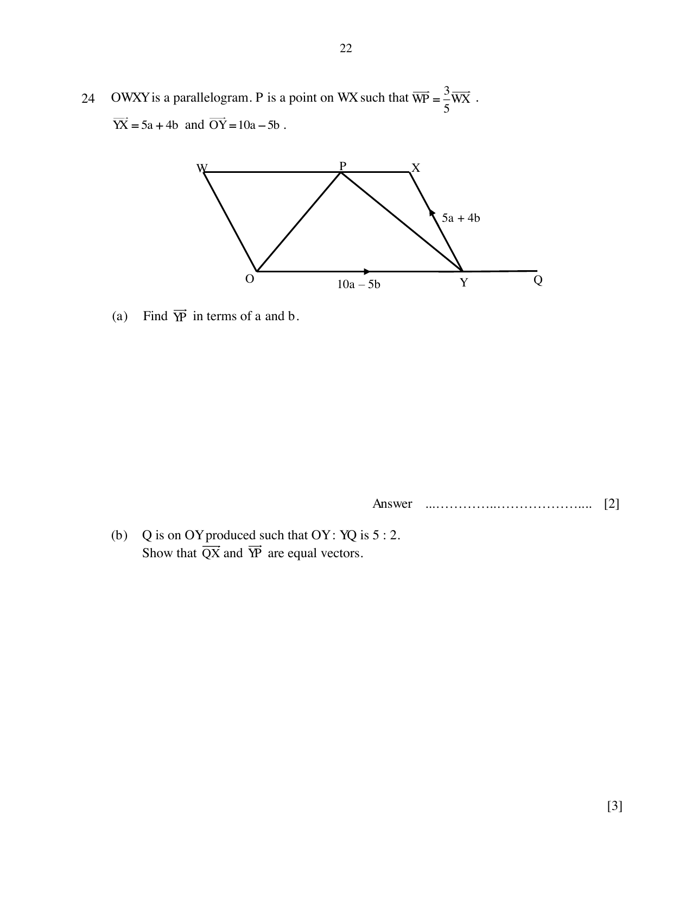

## Question

> **Marks:** (a) 2, (b) 3, (c) 1; total 6
> **Page:** 22–23

$OWXY$ is a parallelogram. $P$ is a point on $WX$ such that $WP=\dfrac{3}{5}WX$.
$\overrightarrow{YX}=5\mathbf{a}+4\mathbf{b}$ and $\overrightarrow{OY}=10\mathbf{a}-5\mathbf{b}$.

**(a)** Find $\overrightarrow{YP}$ in terms of $\mathbf{a}$ and $\mathbf{b}$.

**(b)** $Q$ is on $OY$ produced such that $OY:YQ$ is $5:2$.
Show that $\overrightarrow{QX}$ and $\overrightarrow{YP}$ are equal vectors.

**(c)** Find the value of $\dfrac{\text{area of triangle }PXY}{\text{area of triangle }OPY}$.

## Answer Scheme

**(a)** $\overrightarrow{XP}=\dfrac{2}{5}\overrightarrow{YO}=\dfrac{2}{5}(-10\mathbf{a}+5\mathbf{b})$

$\overrightarrow{YP}=\overrightarrow{YX}+\overrightarrow{XP}=(5\mathbf{a}+4\mathbf{b})+\dfrac{2}{5}(-10\mathbf{a}+5\mathbf{b})=\mathbf{a}+6\mathbf{b}$

**(b)** $\overrightarrow{QY}=\dfrac{2}{5}\overrightarrow{YO}=\overrightarrow{XP}$

$\overrightarrow{QX}=\overrightarrow{QY}+\overrightarrow{YX}=\mathbf{a}+6\mathbf{b}=\overrightarrow{YP}$

**(c)** $\dfrac{2}{5}$
