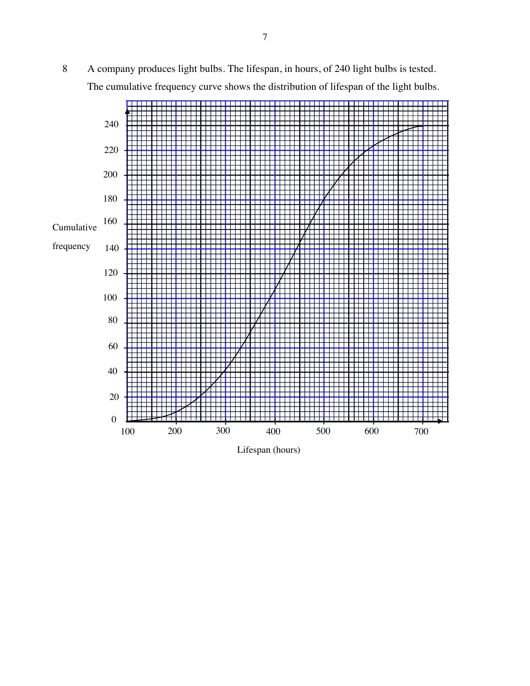

## Question

> **Marks:** (a)(i) 1, (a)(ii) 2, (b) 1; total 4
> **Page:** 7–8

A company produces light bulbs. The lifespan, in hours, of 240 light bulbs is tested.
The cumulative frequency curve shows the distribution of lifespan of the light bulbs.

**(a)** Use the diagram to estimate

**(i)** the median lifespan of the light bulbs,

**(ii)** the interquartile range of the lifespan of the light bulbs.

**(b)** Light bulbs with a lifespan of over $x$ hours can be sold. Only 80 of the light bulbs tested meet this requirement.

Find the value of $x$.

## Answer Scheme

**(a)** **(i)** $420\text{ h}$ ($\pm 2$)

**(ii)** $500-330=170\text{ h}$

**(b)** $x=470$
