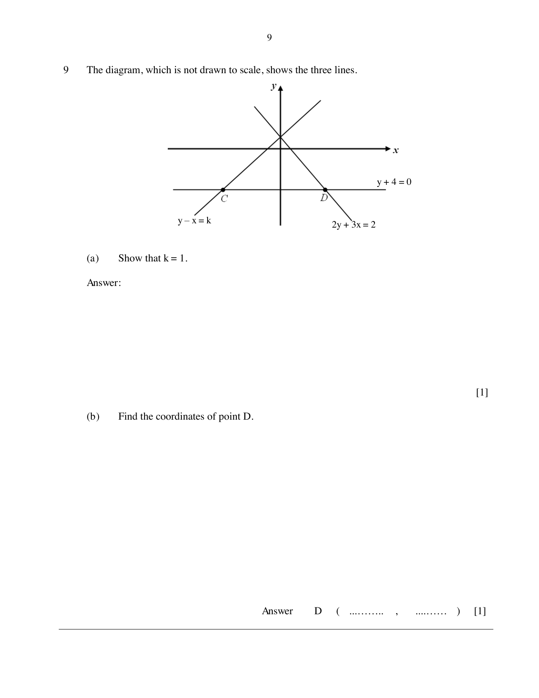

## Question

> **Marks:** (a) 1, (b) 1; total 2
> **Page:** 9

The diagram, which is not drawn to scale, shows the three lines $y+4=0$, $y-x=k$ and $2y+3x=2$.

**(a)** Show that $k=1$.

**(b)** Find the coordinates of point $D$.

## Answer Scheme

**(a)** From $2y+3x=2$, $y=-\dfrac{3}{2}x+1$, so the $y$-intercept is 1 and $k=1$.

**(b)** $2(-4)+3x=2$, so $D\left(\dfrac{10}{3}, -4\right)$
