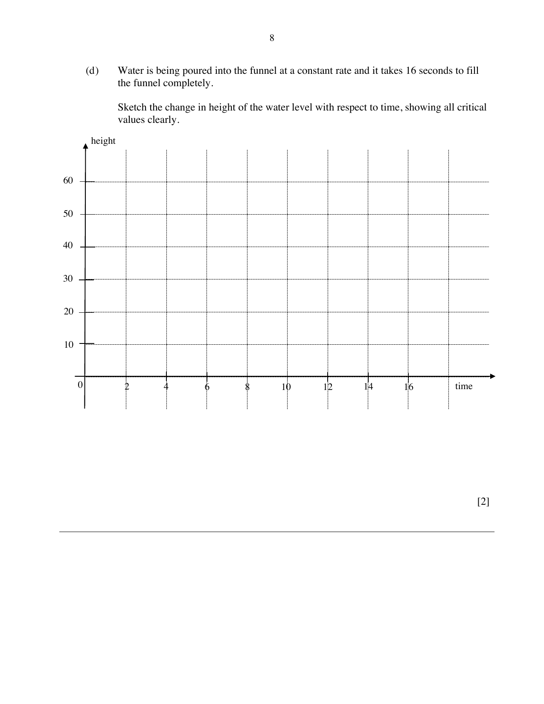

## Question

> **Marks:** (a) 2, (b) 2, (c) 3, (d) 2; total 9
> **Page:** 6–8

The diagram shows an open funnel, consisting of a cylinder and a cone.
The heights of the cylinder and the cone are $1.5h$ cm each, and the radius of both the cylinder and the cone is $0.8h$ cm.

**(a)** Show that the curved surface area of the cone is $1.36\pi h^{2}$.

**(b)** Given that the total surface area of the funnel is $1504\pi\text{ cm}^{2}$, find the value of $h$.

**(c)** A glass rod is placed in the funnel so that one end of the glass rod rests on the edge of the funnel as shown.
When the glass rod is placed vertically from the bottom of the funnel, a part of the glass rod protrudes from the top of the funnel.
Calculate this length of the part of the glass rod that is outside the funnel when placed vertically.

**(d)** Water is being poured into the funnel at a constant rate and it takes 16 seconds to fill the funnel completely.

Sketch the change in height of the water level with respect to time, showing all critical values clearly.

## Answer Scheme

**(a)** Slant height $=\sqrt{(0.8h)^{2}+(1.5h)^{2}}=1.7h$

Curved area $=\pi\times 0.8h\times 1.7h=1.36\pi h^{2}$

**(b)** Total surface area $=1.36\pi h^{2}+2\pi(0.8h)(1.5h)=3.76\pi h^{2}=1504\pi$

$h^{2}=\dfrac{1504}{3.76}$, so $h=20\text{ cm}$

**(c)** Radius $=16\text{ cm}$ and full height $=60\text{ cm}$.

Length of rod $=\sqrt{16^{2}+60^{2}}=62.097$

Length outside the funnel $=2.1\text{ cm}$

**(d)** Sketch on the given axes. The scheme page for the sketch is blank in the text extract; use the critical height 60 cm at 16 s, with the cone filling before the cylinder.
