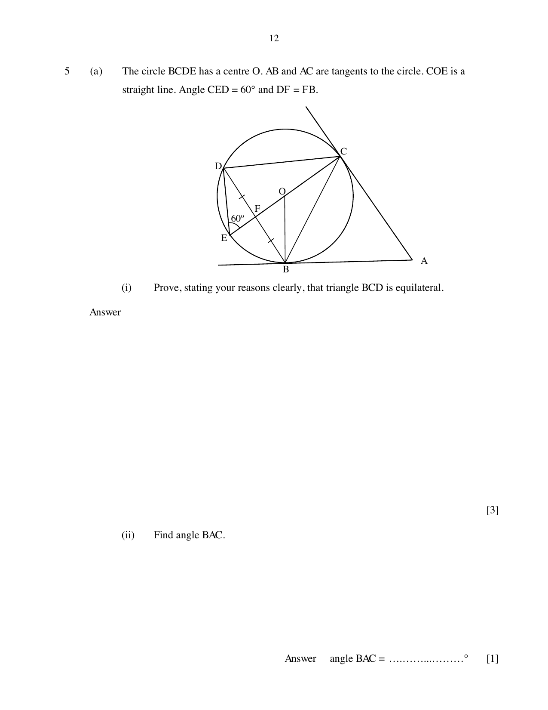

## Question

> **Marks:** (a)(i) 3, (a)(ii) 1, (b)(i) 1, (b)(ii) 1, (b)(iii) 2; total 8
> **Page:** 12–13

**(a)** The circle $BCDE$ has centre $O$. $AB$ and $AC$ are tangents to the circle. $COE$ is a straight line. Angle $CED=60^{\circ}$ and $DF=FB$.

**(i)** Prove, stating your reasons clearly, that triangle $BCD$ is equilateral.

**(ii)** Find angle $BAC$.

**(b)** The first three terms in a sequence of numbers, $T_{1}$, $T_{2}$, $T_{3}$, $\ldots$ are given below.

$T_{1}=\dfrac{1}{2}(2\times 3)=3$

$T_{2}=\dfrac{1}{2}(3\times 4)=6$

$T_{3}=\dfrac{1}{2}(4\times 5)=10$

**(i)** Find $T_{7}$.

**(ii)** Find an expression, in terms of $n$, for $T_{n}$.

**(iii)** 351 is a term in the sequence. Find the value of $n$.

## Answer Scheme

**(a)** **(i)** Angle $CBD=$ angle $CED$ (angles in the same segment).

Angle $DFE=90^{\circ}$ ($OE$ bisects chord $BD$). Angle $FDE=30^{\circ}$ (angle sum in triangle $DFE$).

Angle $CDE=90^{\circ}$ (angle in a semicircle). Angle $BDC=90^{\circ}-30^{\circ}=60^{\circ}$.

Angle $CBD=60^{\circ}$ (angle sum in triangle $BCD$). Hence triangle $BCD$ is equilateral.

Alternative: angle $BED=2\times 60^{\circ}=120^{\circ}$ because triangles $DEF$ and $BEF$ are congruent, then angle $CBD=60^{\circ}$.

**(ii)** Angle $BOC=120^{\circ}$ (angle at the centre is twice the angle at the circumference).

Angle $BAC=360^{\circ}-90^{\circ}-90^{\circ}-120^{\circ}=60^{\circ}$

**(b)** **(i)** $T_{7}=36$

**(ii)** $T_{n}=\dfrac{1}{2}(n+1)(n+2)$

**(iii)** $(n+1)(n+2)=351$ gives $n^{2}+3n-700=0$

$n=-28$ (reject) or $n=25$
