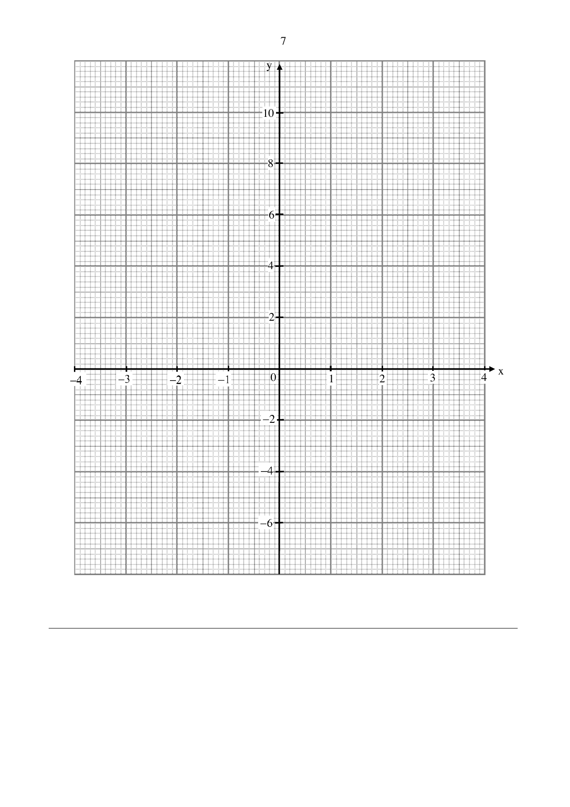

## Question

> **Marks:** (a) 1, (b) 3, (c)(i) 1, (c)(ii) 3, (d) 2; total 10
> **Page:** 6–7

**(a)** Complete the table of values for $y = x^{2}+2x-1$. [1]

| $x$ | $-4$ | $-3$ | $-2$ | $-1$ | $0$ | $1$ | $2$ |
| --- | --- | --- | --- | --- | --- | --- | --- |
| $y$ |  | $2$ | $-1$ | $-2$ | $-1$ | $2$ | $7$ |

**(b)** On the grid, draw the graph of $y = x^{2}+2x-1$ for $-4 \leq x \leq 2$. [3]

**(c)** Use your graph

**(i)** to write down an inequality in $x$ to describe the range of values where $y < 3$, [1]

**(ii)** to solve the equation $x^{2}+2x+\dfrac{1}{2} = 0$. [3]

**(d)** Based on the graph, Eileen stated that the coordinates of the minimum point of the graph is $(-1, -2)$. Show, with working, how you can verify this by expressing $x^{2}+2x-1$ in the form $(x+p)^{2}+q$. [2]

## Answer Scheme

**(a)** $y = 7$ when $x = -4$. B1.

**(b)** 7 points plotted: B2. 4 points: B1. Curve: B1.

**(c)(i)** $-3.25 < x < 1.2$. B1.

**(c)(ii)**

$$
x^{2}+2x+\frac{1}{2} = 0
$$

$$
x^{2}+2x-1 = -1.5, \quad y = -1.5
$$

$$
x = -1.65 \text{ or } x = -0.25
$$

M1, A1, A1.

**(d)**

$$
x^{2}+2x-1 = \left(x+1\right)^{2}-2
$$

Therefore the minimum point is $(-1, -2)$. M1, A1.
