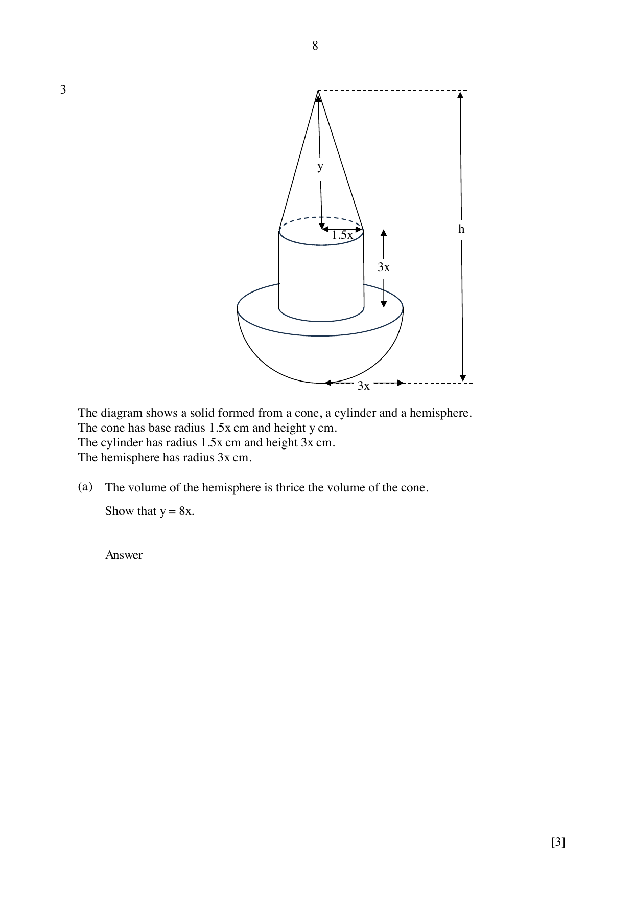

## Question

> **Marks:** (a) 3, (b) 7; total 10
> **Page:** 8–9

The diagram shows a solid formed from a cone, a cylinder and a hemisphere.
The cone has base radius $1.5x\text{ cm}$ and height $y\text{ cm}$.
The cylinder has radius $1.5x\text{ cm}$ and height $3x\text{ cm}$.
The hemisphere has radius $3x\text{ cm}$.

**(a)** The volume of the hemisphere is thrice the volume of the cone. Show that $y = 8x$. [3]

**(b)** The total surface area of the solid is $450\text{ cm}^{2}$. Calculate the total height, $h\text{ cm}$, of the solid. [7]

---

## Section B (59 marks)

## Answer Scheme

**(a)**

$$
\text{Volume of hemisphere} = \frac{2}{3}\pi(3x)^{3} = 18\pi x^{3}
$$

$$
\text{Volume of cone} = \frac{1}{3}\pi\left(\frac{3}{2}x\right)^{2}y = \frac{3\pi}{4}x^{2}y
$$

$$
18\pi x^{3} = 3\times\frac{3\pi}{4}x^{2}y, \quad y = 8x \text{ (shown)}
$$

M1, M1, A1.

**(b)**

$$
l = \sqrt{y^{2}+\left(\frac{3}{2}x\right)^{2}} = \sqrt{64x^{2}+\frac{9}{4}x^{2}} = \frac{\sqrt{265}}{2}x \approx 8.1394x
$$

Curved surface area of cone $= \pi\left(\dfrac{3}{2}x\right)l \approx 38.356x^{2}$.

Curved surface area of cylinder $= 2\pi\left(\dfrac{3}{2}x\right)(3x) \approx 28.274x^{2}$.

Curved surface area of hemisphere $= 2\pi(3x)^{2} \approx 56.549x^{2}$.

Rim area $= \pi(3x)^{2}-\pi\left(\dfrac{3}{2}x\right)^{2} \approx 21.206x^{2}$.

4 correct: M3. 3 correct: M2. 2 correct: M1.

$$
38.356x^{2}+28.274x^{2}+56.549x^{2}+21.206x^{2} = 450
$$

$$
144.385x^{2} = 450, \quad x^{2} = 3.1167, \quad x = 1.7654
$$

$$
h = y+3x+3x = 14x = 14(1.7654) = 24.7 \text{ (3 s.f.)}
$$

M1, M1, A1.
