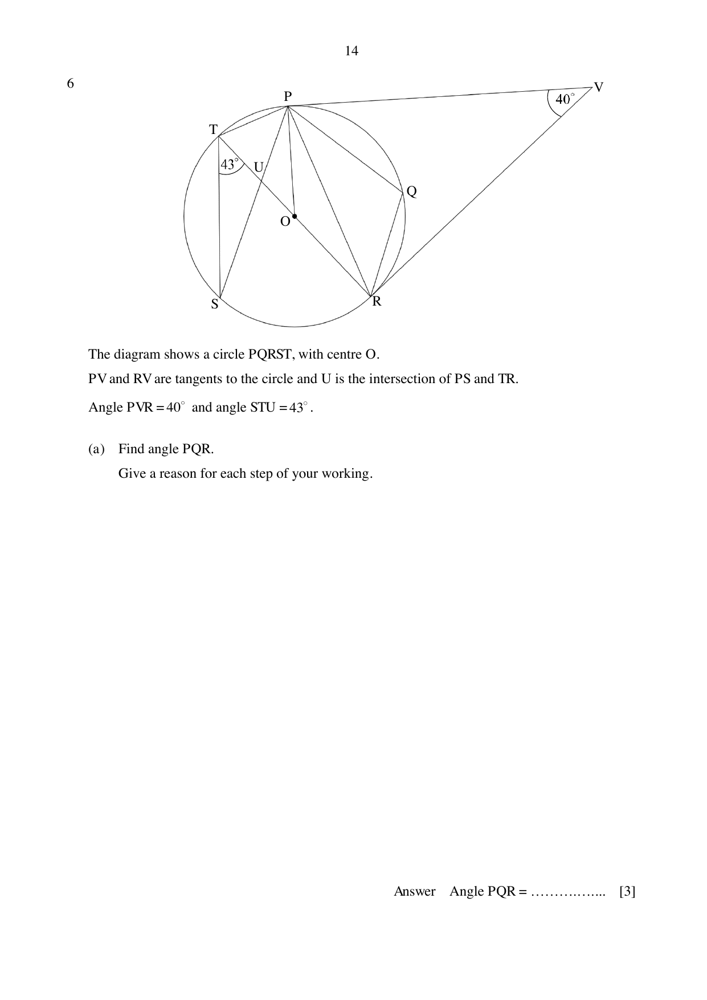

## Question

> **Marks:** (a) 3, (b) 3, (c) 3; total 9
> **Page:** 14–15

The diagram shows a circle $PQRST$, with centre $O$.
$PV$ and $RV$ are tangents to the circle and $U$ is the intersection of $PS$ and $TR$.

$\angle PVR = 40^{\circ}$ and $\angle STU = 43^{\circ}$.

**(a)** Find $\angle PQR$. Give a reason for each step of your working. [3]

**(b)** Find $\angle TUP$. Give a reason for each step of your working. [3]

**(c)** Alice claims that the area of the minor sector $OSR$ is more than one third of the area of the major sector $OSR$. Do you support her claim? Justify your decision with calculations. [3]

## Answer Scheme

**(a)** $\angle OPV = \angle ORV = 90^{\circ}$ (tangent perpendicular to radius).

$\angle POR = 360^{\circ}-90^{\circ}-90^{\circ}-40^{\circ} = 140^{\circ}$ (sum of quadrilateral).

Reflex $\angle POR = 360^{\circ}-140^{\circ} = 220^{\circ}$ (angles at a point).

$$
\angle PQR = \frac{220^{\circ}}{2} = 110^{\circ}
$$

(angle at the centre $= 2\times$ angle at the circumference). M1, M1, A1.

**(b)**

$$
\angle OPR = \frac{180^{\circ}-140^{\circ}}{2} = 20^{\circ}
$$

(sum of isosceles triangle).

$\angle SPR = \angle STR = 43^{\circ}$ (angles in the same segment).

$\angle OPU = 43^{\circ}-20^{\circ} = 23^{\circ}$.

$\angle POU = 180^{\circ}-140^{\circ} = 40^{\circ}$ (angles on a straight line).

$\angle TUP = \angle OPU+\angle POU = 23^{\circ}+40^{\circ} = 63^{\circ}$ (exterior angle of a triangle). M1, M1, A1.

**(c)** $\angle SOR = 2\times\angle STR = 86^{\circ}$. Reflex $\angle SOR = 274^{\circ}$.

$$
\text{Area of minor sector} = \frac{86}{274}\times\text{area of major sector} = 0.31387\times\text{area of major sector}
$$

No, because the area of the minor sector is $0.314$ of the area of the major sector, which is less than $\dfrac{1}{3}$ ($0.333$). M1, M1, A1.
