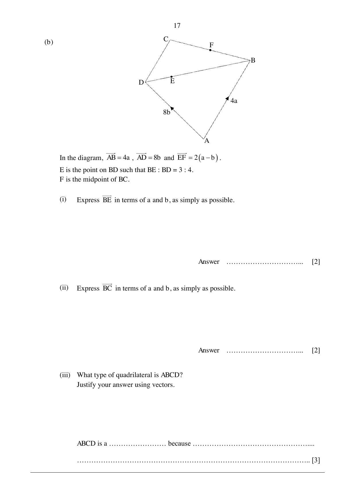

## Question

> **Marks:** (a)(i) 1, (a)(ii) 2, (a)(iii) 2, (b)(i) 2, (b)(ii) 2, (b)(iii) 3; total 12
> **Page:** 16–17

**(a)** The position vector of point $X$ is $\begin{pmatrix} 8 \\ -4 \end{pmatrix}$. The position vector of point $Y$ is $\begin{pmatrix} 6 \\ 4 \end{pmatrix}$.

**(i)** Find the vector that represents the translation from $X$ to $Y$. [1]

**(ii)** Find the magnitude of $XY$. [2]

**(iii)** $Z$ has coordinates $(-1, k)$ and lies on the line $XY$ produced. Find the position vector of point $Z$. [2]

**(b)**

In the diagram, $\overrightarrow{AB} = 4\mathbf{a}$, $\overrightarrow{AD} = 8\mathbf{b}$ and $\overrightarrow{EF} = 2(\mathbf{a}-\mathbf{b})$.
$E$ is the point on $BD$ such that $BE:BD = 3:4$.
$F$ is the midpoint of $BC$.

**(i)** Express $\overrightarrow{BE}$ in terms of $\mathbf{a}$ and $\mathbf{b}$, as simply as possible. [2]

**(ii)** Express $\overrightarrow{BC}$ in terms of $\mathbf{a}$ and $\mathbf{b}$, as simply as possible. [2]

**(iii)** What type of quadrilateral is $ABCD$? Justify your answer using vectors. [3]

## Answer Scheme

**(a)(i)**

$$
\begin{pmatrix} 6 \\ 4 \end{pmatrix}-\begin{pmatrix} 8 \\ -4 \end{pmatrix} = \begin{pmatrix} -2 \\ 8 \end{pmatrix}
$$

B1.

**(a)(ii)**

$$
XY = \sqrt{(-2)^{2}+8^{2}} = 8.2462 = 8.25\text{ units}
$$

M1, A1.

**(a)(iii)**

$$
\frac{k-4}{-1-6} = \frac{8}{-2}, \quad k = 32
$$

$$
\overrightarrow{OZ} = \begin{pmatrix} -1 \\ 32 \end{pmatrix}
$$

M1, A1.

**(b)(i)** $\overrightarrow{BD} = 8\mathbf{b}-4\mathbf{a}$.

$$
\overrightarrow{BE} = \frac{3}{4}(8\mathbf{b}-4\mathbf{a}) = 6\mathbf{b}-3\mathbf{a}
$$

M1, A1.

**(b)(ii)** $\overrightarrow{BF} = 6\mathbf{b}-3\mathbf{a}+2\mathbf{a}-2\mathbf{b} = 4\mathbf{b}-\mathbf{a}$.

$$
\overrightarrow{BC} = 2\overrightarrow{BF} = 8\mathbf{b}-2\mathbf{a}
$$

M1, A1.

**(b)(iii)** $\overrightarrow{DC} = \overrightarrow{BC}-\overrightarrow{BD} = 2\mathbf{a}$.

$\overrightarrow{AB} = 2\overrightarrow{DC}$ and $\overrightarrow{AB}$ is parallel to $\overrightarrow{DC}$.

$ABCD$ is a trapezium because $AB = 2\,DC$ and $AB$ is parallel to $DC$ (one pair of opposite sides parallel). M1, M1, A1.
