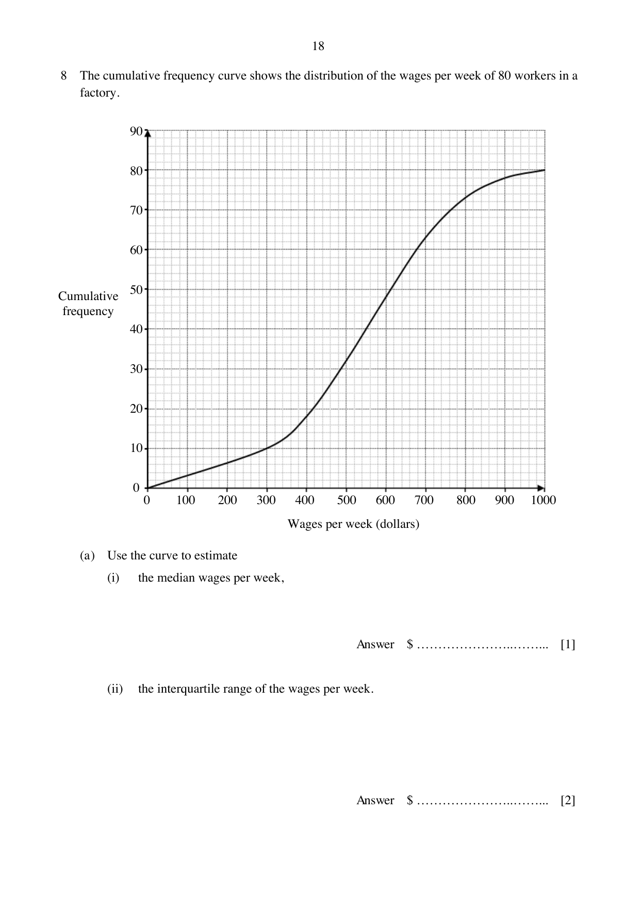

## Question

> **Marks:** (a)(i) 1, (a)(ii) 2, (b) 2, (c) 2, (d) 3; total 10
> **Page:** 18–19

The cumulative frequency curve shows the distribution of the wages per week of 80 workers in a factory.

**(a)** Use the curve to estimate

**(i)** the median wages per week, [1]

**(ii)** the interquartile range of the wages per week. [2]

**(b)** In June 2024, the average wages per week of factory workers in Singapore was ＄540. Calculate the percentage of the workers in the factory who earned more than this average. [2]

**(c)** Find the number of workers who earned between ＄460 and ＄800. [2]

**(d)** The factory employed more workers and paid them not more than ＄650 per week. Find the additional number of workers employed if the probability of choosing a worker who earned not more than ＄650 is $\dfrac{11}{15}$. [3]

## Answer Scheme

**(a)(i)** $\dfrac{50}{100}\times 80 = 40$. Median $= ＄550$. B1.

**(a)(ii)** Lower quartile at cumulative frequency $20$ is ＄420. Upper quartile at $60$ is ＄680.

Interquartile range $= 680-420 = ＄260$. M1, A1.

**(b)** Number of workers earning at most ＄540 is $38$, so more than ＄540 is $42$.

$$
\frac{42}{80}\times 100\% = 52.5\%
$$

M1, A1.

**(c)** Workers at most ＄460: $26$. At most ＄800: $73$. Between them: $73-26 = 47$. M1, A1.

**(d)** Workers now earning at most ＄650: $56$. Let the additional number be $x$.

$$
\frac{56+x}{80+x} = \frac{11}{15}, \quad x = 10
$$

M1, M1, A1.
