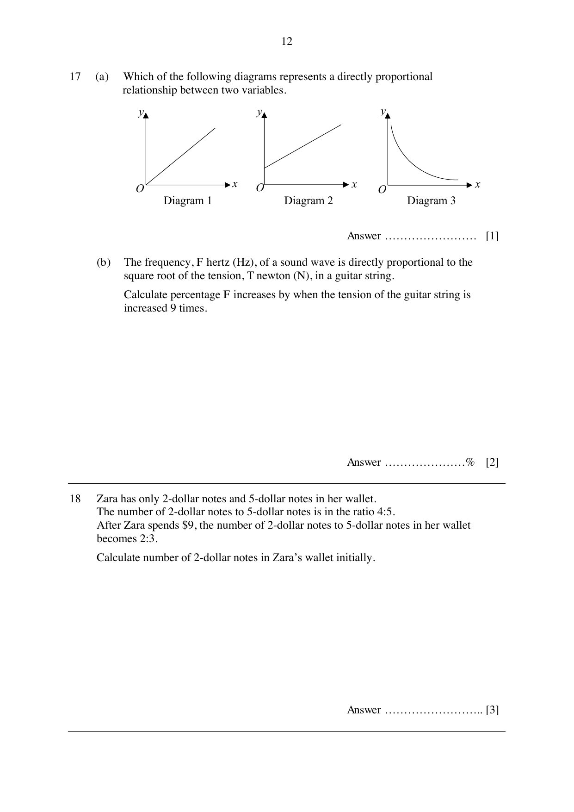

## Question

> **Marks:** 3
> **Page:** 12

(a) Which of the following diagrams represents a directly proportional relationship between two variables. [1]

Diagram 1 is a straight line through the origin. Diagram 2 is a straight line that does not pass through the origin. Diagram 3 is a curve.

(b) The frequency, $F$ hertz (Hz), of a sound wave is directly proportional to the square root of the tension, $T$ newton (N), in a guitar string.
Calculate percentage $F$ increases by when the tension of the guitar string is increased 9 times. [2]
