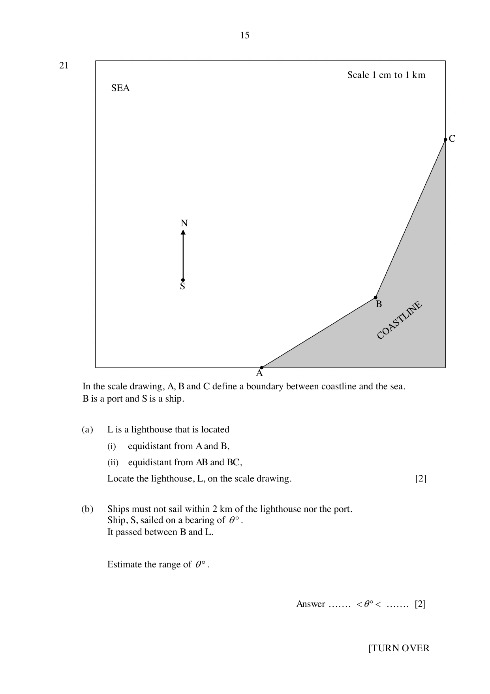

## Question

> **Marks:** 4
> **Page:** 15

Scale: 1 cm to 1 km.

In the scale drawing, $A$, $B$ and $C$ define a boundary between coastline and the sea.
$B$ is a port and $S$ is a ship. North is marked.

(a) $L$ is a lighthouse that is located

(i) equidistant from $A$ and $B$,

(ii) equidistant from $AB$ and $BC$.

Locate the lighthouse, $L$, on the scale drawing. [2]

(b) Ships must not sail within 2 km of the lighthouse nor the port.
Ship, $S$, sailed on a bearing of $\theta^{\circ}$.
It passed between $B$ and $L$.

Estimate the range of $\theta^{\circ}$. [2]
